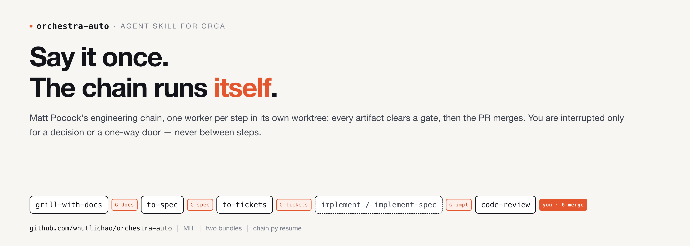
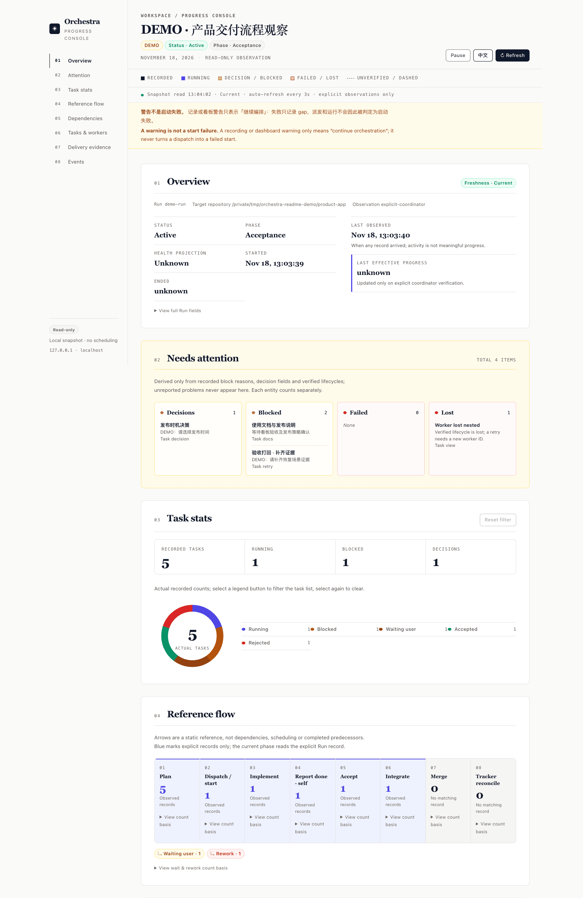

# orchestra-auto

**[English](README.md) · [简体中文](README.zh-CN.md)**

[](https://skills.sh/whutlichao/orchestra-auto) [](https://github.com/whutlichao/orchestra-auto/actions/workflows/tests.yml) [](./LICENSE)



An Agent Skill that runs [Matt Pocock's engineering skill chain](https://github.com/mattpocock/skills) on [Orca](https://www.onorca.dev/) as one supervised loop. Say what you want once — the coordinator dispatches each step into its own worktree, checks its gate, and merges when authorized (a PR-only request stays open). You only step in for decisions or one-way doors.

> **Requires [Orca](https://www.onorca.dev/) (`orca orchestration`) and [Matt Pocock's skills](https://github.com/mattpocock/skills).** Independent community workflow; not affiliated with or endorsed by Matt Pocock.

## Install

```bash
# English
npx skills add whutlichao/orchestra-auto --skill orchestra-auto

# 简体中文
npx skills add whutlichao/orchestra-auto --skill orchestra-auto-zh
```

- Uses the community [`skills` CLI](https://github.com/vercel-labs/skills) (not `orca skills install`). Add `--global` or `--agent <name>` as needed.
- Both language variants are independent bundles with identical scripts and workflow rules.

## How it works

Enter at whichever stage you already have — from rough idea to spec, tickets, or direct implementation:

1. **Route** — Picks the matching step (`grill-me` / `grill-with-docs` / `wayfinder` → `to-spec` → `to-tickets` → `implement` or long-horizon `implement-spec`, plus `diagnosing-bugs`, `research`, `triage`, `domain-modeling`, `retro`).
2. **Isolate & dispatch** — Dispatches one worker per step in a fresh top-level worktree (`--worktree new-top-level`) using an enabled Orca agent. The coordinator never edits project files directly.
3. **Gate & escalate** — Verifies deliverables by ticket type (`tdd`, `code-review`, diff/reflow checks). Decision-class questions (scope, approach forks, credentials, third parties, paid services, manual approvals, irreversible live data) always come back to you.
4. **Land & closeout** — Authorized two-way green PRs merge and sync `main`; one-way Merge Danger doors and PR-only requests stay open for a human. Workers release only after settlement and durable closeout.

Core safety rules:

- `state: ready` is not a started turn (`turnStart: observed` or attempt evidence is required), and `worker_done` is not acceptance.
- Flow state, ledgers, and progress logs live outside the repository (`scripts/flow.py`, `scripts/chain.py`, `scripts/preflight.py`, `scripts/closeout.py`).
- Full rules live in [skills/orchestra-auto/SKILL.md](skills/orchestra-auto/SKILL.md).

## Prerequisites and capability boundary

- **Orca** with a reachable CLI (`ORCA_CLI_COMMAND`, `orca`, `orca-dev`, or `orca-ide`) and enabled TUI worker agents.
- **Matt Pocock's skills** installed locally (referenced by path in worker specs).
- **Node.js / `npx`** to install via the `skills` CLI.
- **Python 3** (stdlib only, macOS/Linux/WSL) for orchestration helper scripts and the local dashboard.

## Local progress dashboard

A read-only, non-blocking localhost sidecar (Python 3 stdlib, no database or credentials). Started before the first dispatch of a real Run, the coordinator initializes state outside the repo and runs `open` to register the Run and start the per-user service; if the browser cannot launch, the printed URL can be opened manually. Dashboard errors never block dispatch.

The service tracks registered Runs via `run_states` with a top bar dropdown to switch between them. History is never deleted by the service or `open` — only an explicit `registry prune` archives ended Runs into `archive/`.



Try an offline **DEMO** with `serve` (prints `http://127.0.0.1:8766/` and never opens a browser):

```bash
python3 skills/orchestra-auto/scripts/progress-demo.py --state "$AUDIT_ROOT/demo-example" --target-repo "$PWD"
python3 skills/orchestra-auto/scripts/progress.py --state "$AUDIT_ROOT/demo-example" serve --port 8766
```

## Repository & verification

```text
skills/
├── orchestra-auto/      English bundle (SKILL.md: 8,819 bytes / ~2,204 tokens; references/: eight files)
└── orchestra-auto-zh/   Chinese bundle (SKILL.md: 8,026 bytes / ~2,006 tokens; same structure)
tests/                   Offline unittest suite (scripts, dashboard, package parity, leak scan)
docs/                    Design docs, architecture specs, and demo assets (see docs/INDEX.md)
```

Run the full offline test suite (no network or credentials needed):

```bash
python3 -m unittest discover -s tests -v
```

Each bundle also ships **52 prompt-level scenarios** in `evals/evals.json` (the cross-language parity test checks anchors, not full semantic equivalence). See [docs/INDEX.md](docs/INDEX.md) for architecture docs and [CONTRIBUTING.md](CONTRIBUTING.md) for contribution guidelines.

## Credits & License

- Planning skills: [Matt Pocock](https://github.com/mattpocock/skills) (not affiliated with or endorsing this repository).
- Contributors: [@dxnnystyles](https://github.com/dxnnystyles) ([PR #49](https://github.com/whutlichao/orchestra-auto/pull/49)).
- License: [MIT](LICENSE), copyright 2026 whutlichao.
