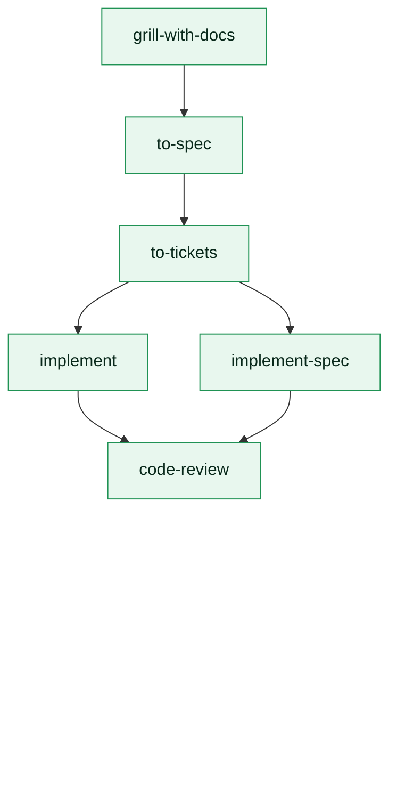
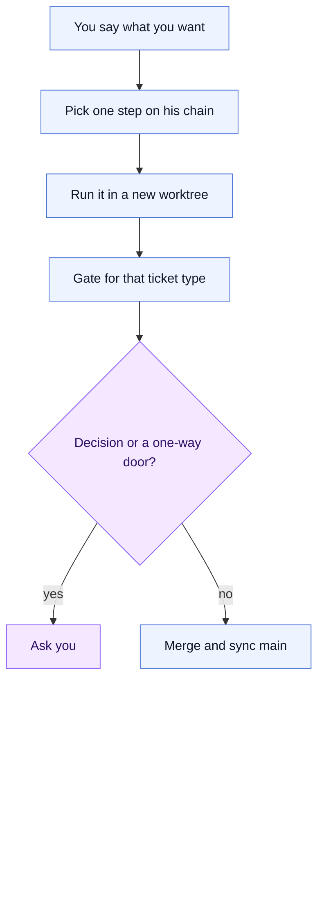
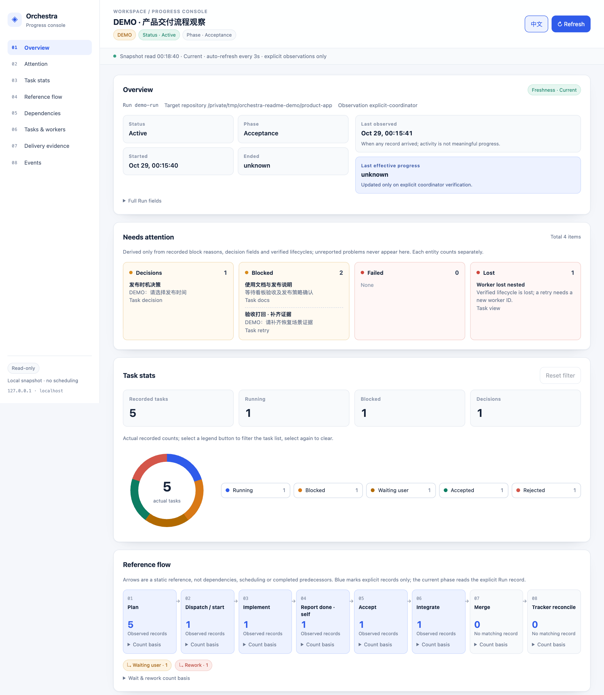
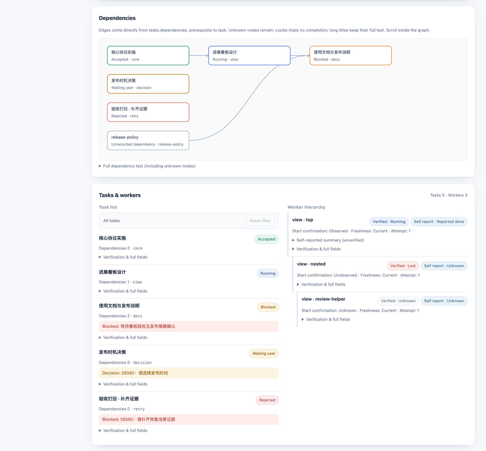

# orchestra-auto

**[English](README.md) · [简体中文](README.zh-CN.md)**

[](https://skills.sh/whutlichao/orchestra-auto) [](#verification) [](./LICENSE)

An Orca best practice built around [Matt Pocock's engineering skills](https://github.com/mattpocock/skills). The chain is his. Supervision, isolation, gates and merging are [Orca](https://www.onorca.dev/)'s.

Dispatch is easy; the last 20% is the hard part — supervised Orca orchestration skills.

<video src="https://github.com/user-attachments/assets/c375a505-a7eb-436a-89d3-e08bce5f16f6" controls width="720" poster="docs/demo/orchestra-auto-poster.jpg"></video>

[Watch the demo (MP4)](https://github.com/user-attachments/assets/c375a505-a7eb-436a-89d3-e08bce5f16f6)

```bash
npx skills add whutlichao/orchestra-auto --skill orchestra-auto
```

Two installable Agent Skills carry the same practice in two languages. This command installs the
English one; the 简体中文 variant is `--skill orchestra-auto-zh` (see [Install](#install)). Chinese
readers can start from [README.zh-CN.md](README.zh-CN.md).

Matt Pocock has not worked on this repository or maintained it, and he does not endorse it.

## The chain is his

The main chain stays in the order he publishes it: `grill-with-docs` → `to-spec` → `to-tickets`, then `implement` or `implement-spec`, closing with `code-review`. The text of those skills lives in his repository. This repository only says how each step runs on Orca: who invokes it, which worktree the worker lands in, when a merge is automatic, and when a human is asked.

| Skill | What that step does |
| --- | --- |
| [`grill-with-docs`](https://github.com/mattpocock/skills/blob/main/skills/engineering/grill-with-docs/SKILL.md) | Interviews against the codebase until this change is sharp. Terms go into the glossary; hard decisions go into ADRs |
| [`to-spec`](https://github.com/mattpocock/skills/blob/main/skills/engineering/to-spec/SKILL.md) | Turns what is already settled into a spec and publishes it to the issue tracker. This step does not interview again |
| [`to-tickets`](https://github.com/mattpocock/skills/blob/main/skills/engineering/to-tickets/SKILL.md) | Splits a plan, a spec or the current conversation into tickets with blocking edges. He calls each one a tracer bullet: thin, complete, demoable on its own |
| [`implement`](https://github.com/mattpocock/skills/blob/main/skills/engineering/implement/SKILL.md) | Builds one settled piece of work. Drives `tdd` at the agreed seams and runs `code-review` before committing |
| [`implement-spec`](https://github.com/mattpocock/skills/blob/main/skills/engineering/implement-spec/SKILL.md) | Lands a whole spec on one integration branch. Tickets are a task graph; ready tickets run in parallel, each in its own worktree, then `code-review` |

Enter at the step you already have. A single settled ticket uses `implement`. A complete map goes to one long-horizon `implement-spec` worker. A request for only design, only a spec, or only tickets stops once that step's PR is merged.



`implement` and `implement-spec` call `tdd` inside the ticket. When the request is still too foggy to form a stable requirement, his [`wayfinder`](https://github.com/mattpocock/skills/blob/main/skills/engineering/wayfinder/SKILL.md) lays out decision tickets first, and `to-spec` waits until the way is clear.

## What changes when Orca runs it

The names in the diagram above stay. What changes, at each step forward, is who acts, where the edit lands, and whether a human has to appear.

| | You invoke his skills yourself | orchestra-auto runs the same skills on Orca |
| --- | --- | --- |
| Who advances the next step | You invoke them one by one | The coordinator dispatches one worker for this round's request. The worker runs that one skill |
| Where the edit lands | The checkout the session is already in | Each task gets a new top-level worktree. An `implement-spec` implementer gets its own worktree and branch as well. The coordinator does not edit those worktrees |
| When a human appears | You stay in the session and keep moving | You say what you want at the start. Decision-class questions come back to you: deliverable shape, approach forks, scope, and credentials, third parties, payment, manual approval, irreversible live-data operations. You also merge a one-way Merge Danger door |
| How the work lands | However the target repo's tracker already does it | A project change opens a PR by default. Once the gates pass and the door is two-way, the coordinator merges and syncs main |



When the chain continues, the next step is another lap of the same loop: another worker, another new top-level worktree. A one-way door stays on the "Ask you" branch. The spec names that skill's absolute path on disk. If the spec does not say it, the worker does not do it.

These situations still use his skills:

| Situation | Skill |
| --- | --- |
| A bug fix | [`diagnosing-bugs`](https://github.com/mattpocock/skills/blob/main/skills/engineering/diagnosing-bugs/SKILL.md), then `implement` |
| Research that must land on disk | [`research`](https://github.com/mattpocock/skills/blob/main/skills/engineering/research/SKILL.md) |
| An external issue | [`triage`](https://github.com/mattpocock/skills/blob/main/skills/engineering/triage/SKILL.md) |
| Terminology that is not aligned | [`domain-modeling`](https://github.com/mattpocock/skills/blob/main/skills/engineering/domain-modeling/SKILL.md) |
| A process error, not a product bug | [`retro`](https://github.com/mattpocock/skills/blob/main/skills/engineering/retro/SKILL.md). Candidates are written outside the target repository. A human selects one before a worker lands it |

What Orca adds:

- The coordinator plans, dispatches, answers and accepts. Edits, commits and the PR body for project files are done by the worker inside that ticket's worktree.
- `state: ready` only means the dispatch is ready. A started turn shows up as `turnStart: observed`, or as other evidence that agent supports.
- The worker's agent comes from Orca's current settings and stays off the current disabled list.
- Decision-class questions go to a human first. A worker's recommendation is reference only.
- The gate follows the ticket type. A design ticket does not run source tests. An implementation ticket does not skip its review. A small bounded change may skip the two-axis review when the reason is written into the spec and the Answer.
- An unusual diff is preserved before anyone reverts it. A failure is evidenced before anyone decides to re-dispatch.

Dispatch flags, the inbox, send-backs and the breakers live in [SKILL.md](skills/orchestra-auto/SKILL.md). The two diagrams keep his chain, and the one lap Orca wraps around a step of it.

## Install

This repository publishes **two installable Agent Skills** that carry the same practice in two
languages:

| Skill | Language | Install |
| --- | --- | --- |
| [`orchestra-auto`](skills/orchestra-auto/SKILL.md) | English | `npx skills add whutlichao/orchestra-auto --skill orchestra-auto` |
| [`orchestra-auto-zh`](skills/orchestra-auto-zh/SKILL.md) | 简体中文 | `npx skills add whutlichao/orchestra-auto --skill orchestra-auto-zh` |

Both skills install with the community [`skills` CLI](https://github.com/vercel-labs/skills)
(`npx skills add …,`). Pick the language variant you want; they are independent bundles, not a
translation fallback, so installing both is fine if your team is bilingual.

```bash
# English
npx skills add whutlichao/orchestra-auto --skill orchestra-auto

# 简体中文
npx skills add whutlichao/orchestra-auto --skill orchestra-auto-zh
```

Add `--global` to install user-wide rather than into the current project, and
`--agent <name>` to target specific agents:

```bash
npx skills add whutlichao/orchestra-auto --skill orchestra-auto --global --agent claude-code
```

You can also install **both** variants from a checkout of this repository:

```bash
git clone https://github.com/whutlichao/orchestra-auto
npx skills add ./orchestra-auto --skill orchestra-auto --skill orchestra-auto-zh
```

`orca skills install` is Orca's own wrapper around the same `npx` command, but only for the skills
Orca bundles in its local registry. Running `orca skills install --skill orchestra-auto` fails with
`Unknown skill`, because these packages are not in that registry — use the `npx skills add` commands
above for this repository.

> **Orca prerequisite.** Both skills drive the **Orca CLI** (`orca orchestration …`). They are not a
> general agent-orchestration layer and do not work without Orca installed and its CLI reachable.
> See [Prerequisites and capability boundary](#prerequisites-and-capability-boundary) before you
> install. A worker also needs Matt Pocock's skills on disk. This repository does not ship them.

### What the install command does, and does not do

- **GitHub is the source.** The skill contents live in this repository; the CLI reads them from
  GitHub at install time. Nothing is uploaded from your machine.
- **The `skills` CLI installs; this repository does not.** The install command is the community CLI
  fetching a public repository. There is no submission step here, and no approval queue.
- **skills.sh is a directory that fills itself in.** Per the
  [skills.sh FAQ](https://skills.sh/docs/faq), a repository appears on the leaderboard
  automatically from anonymous install telemetry once people run the install command — there is no
  author-facing submission form to file. **This README therefore makes no claim that this
  repository is already listed on skills.sh**, and none of us can make that claim on the project's
  behalf: the listing is an observable consequence of real installs, not an action an author takes.
  You can check the current state yourself at `https://skills.sh/whutlichao/orchestra-auto`.
- **Telemetry is the ranking input, and it is opt-out.** The CLI reports aggregate install telemetry
  that includes the public repository and skill identifiers; per the skills.sh FAQ it carries no
  personal or device information. `DISABLE_TELEMETRY=1` and `DO_NOT_TRACK=1` turn it off, as the CLI
  documents. Setting either on your own machine is fine and does not break anything here. Nobody
  should be installing this purely to move a number.
- **This repository ships no loader script.** The skills are Markdown instructions plus one
  standard-library Python script; installing them runs nothing at install time.

## Prerequisites and capability boundary

The skills are **Orca-specific**. Read this before installing.

| Requirement | Detail |
| --- | --- |
| Node.js and `npx` | The community `skills` CLI runs through `npx`; Node.js must be installed to run the install command. Nothing else here needs Node. |
| Orca | The [Orca](https://www.onorca.dev/) app with a reachable CLI. The skills call `orca orchestration worker-start`, `check`, `send`, `reply`, `worker-release` and friends. |
| Matt Pocock's engineering skills | The worker reads his skills, not a copy from this repository. [`grill-with-docs`](https://github.com/mattpocock/skills/blob/main/skills/engineering/grill-with-docs/SKILL.md), [`to-spec`](https://github.com/mattpocock/skills/blob/main/skills/engineering/to-spec/SKILL.md), [`to-tickets`](https://github.com/mattpocock/skills/blob/main/skills/engineering/to-tickets/SKILL.md), [`implement`](https://github.com/mattpocock/skills/blob/main/skills/engineering/implement/SKILL.md), [`implement-spec`](https://github.com/mattpocock/skills/blob/main/skills/engineering/implement-spec/SKILL.md), and the `tdd` and `code-review` skills they call, must be installed where the worker can read them. The spec names the absolute path. |
| Orca CLI executable | Resolved the way Orca documents it: `ORCA_CLI_COMMAND`, then the platform binary name, then `orca`. |
| The Orca `orchestration` guide | The skills tell the coordinator to fetch it with `orca skills get orchestration` and treat the live guide as authoritative over their own prose. |
| Worker agents | Whatever TUI agents your Orca profile has enabled. The skills read the current default and the current disabled list rather than naming one. |
| Python 3 | Only for the optional bundled inbox loop (standard library only: POSIX file locks, so macOS/Linux/WSL). |

**Capability boundary.** The planning chain is Matt Pocock's. This repository does not redefine what those skills do. The orchestration verbs are Orca's. The judgements
— channel selection, gate choice, decision classification — are transferable, and another
orchestrator could borrow them, but the *commands* are not portable, and the skill will not pretend
they are. If your CLI does not expose `orca orchestration`, this skill is not for you.

Where the skills describe a version-specific detail (an exact settings file, a receipt field name),
they deliberately point at the **current** CLI help and the **current** Orca guide instead of
hardcoding a value, and tell the coordinator to raise a question with evidence when its planned
command does not match the public documentation.

## Verification

The repository is checked with `python3 -m unittest discover`, which runs two suites. No network, no
credentials, and no dependence on any particular machine:

```bash
python3 -m unittest discover -s tests -v
```

- `tests/test_inbox_loop.py` drives the real inbox script against a stub CLI and asserts the
  safety-critical behaviours: atomic persistence, completeness against a re-read, duplicate
  deliveries not overwriting the first read, heartbeat-only batches being acknowledged while normal
  and mixed batches are not, a CLI error failing loudly instead of looking like an empty queue, and
  the single-consumer lock. It also pins the wake contract — a newly persisted non-heartbeat batch
  ends the process with one parseable line on stdout, a heartbeat-only batch does not, and a worker
  state change does — plus the native `check --wait` path, its stderr keepalives, and the reinstall
  after a timeout. It also pins process lifetime: a CLI child never outlives the call that owns it,
  so a failing worker-state probe or a signal that lands during a nested call reaps every child the
  loop started instead of leaving one holding a waiter slot.
- `tests/test_package_content.py` checks the package itself: parity between the two language
  variants, frontmatter validity with `name` matching the directory, every relative link resolving,
  every shipped reference being reachable and declaring its trigger, eval JSON shape and uniqueness,
  the `eval.yaml` allowlist, `py_compile` on the Python, `bash -n` on the shell wrapper, the MIT
  licence, and the leak scan. A prose-contract suite pins the decisions the documents used to
  get wrong: the three dispatch checkpoints and which of them can block a dispatch, the four
  frontier states, the four acceptance levels, one authoritative Merge Danger definition, the
  start-verification scenarios and the real eval count in this README.

The recorded result is **90 OK (1 skipped)**. This is the primary structural and behavioral gate.

Individual check commands, if you want them directly:

```bash
python3 -m py_compile skills/*/scripts/inbox-loop.py
bash -n skills/*/scripts/inbox-loop.sh
python3 -c "import json,glob;[json.load(open(p)) for p in glob.glob('skills/*/evals/*.json')+['skills.sh.json']]"
```

### On-demand loading and activation cost

Under the Agent Skills convention, a host injects the full `SKILL.md` when the skill activates;
files under `references/` are read only when the routing table points to them. [PR #2](https://github.com/whutlichao/orchestra-auto/pull/2)
moved dispatch-loop detail to `references/dispatch-loop.md` and reply detail to
`references/reply-protocol.md`. The always-loaded entrypoint keeps the routing table and hard rules,
including `--worktree new-top-level`, explicit `--agent`, `state:ready` ≠ `turnStart`, and
pre-dispatch `worker-start --help` / registry confirmation.

Compared with pre-thin commit `fbb09b9`, the entrypoint sizes are:

| Variant | `SKILL.md` bytes | Approx. tokens (bytes ÷ 4) |
| --- | ---: | ---: |
| English | 30,208 → 20,287 (−32.8%) | 7,552 → 5,071 |
| Chinese | 24,359 → 15,963 (−34.5%) | 6,089 → 3,990 |

The token figures use **bytes ÷ 4**, not a tokenizer measurement. Total package bytes barely change
because the detail remains in the references. If a turn loads both new references, activation
savings are not whole-turn savings.

### Automated disclosure scan

`LeakScanTests` in `tests/test_package_content.py` is the automated half of the disclosure check. It
scans every published text file for the shapes that must never ship: absolute home-directory paths, a
specific profile database filename, credential-style variable names, and token literals. Four
properties matter as much as the patterns:

1. **No private literal is written down.** The scanner holds generic *shapes*, never the exact
   private repository name, account name or credential variable name — putting those in a published
   scanner would publish the very identifiers the scan exists to keep out. The exact values are
   checked out of band: `PRIVATE_IDENTIFIERS=<a,b,c> python3 -m unittest tests.test_package_content`
   runs the same scan against the values you name. Without that variable the case **skips** and says
   so, so it is never mistaken for coverage it does not have.
2. **It is explainable.** Every exception is granted per **(file, pattern)** pair rather than per
   file. Exempting a whole file would also excuse it from the path, credential and token checks —
   which is how a disclosure scan quietly stops covering the files people edit most. Tests assert
   that the only file which exempts itself is the scanner's own source, that each such entry really
   corresponds to a pattern present there, and that a non-exempt pattern still fails inside an
   exempted file.
3. **It does not cry wolf.** The inbox script uses random UUIDs as temporary-file tokens. A
   `test_random_uuid_tokens_are_not_reported_as_credentials` case asserts that those UUIDs match no
   credential pattern, so a real finding is not lost in noise.
4. **The generic shapes still bite.** A `test_generic_credential_pattern_catches_a_realistic_secret_name`
   case asserts the credential shape matches realistic variable names (all-caps with a `_TOKEN` or
   `_API_KEY` suffix) and does not match ordinary prose, so replacing literal names with a shape
   cannot silently turn the check into a no-op.

Two manual checks belong beside it, and neither can be automated from inside the repository:

- **Read your own diff for anything identifying.** `git diff <base>...HEAD` by eye, file by file,
  before pushing. This is what catches a genuine leak in prose that no pattern anticipated.
- **Confirm the authorship surface.** The copyright holder appears in `LICENSE`, both READMEs and
  the launch kit on purpose; anywhere else is a disclosure failure.

## Evals

Each language variant ships an `evals/evals.json` with 31 prompt-level scenarios covering channel
routing, worker-slot resolution, start verification (including `turnStart: observed`, an
unsupported receipt, and a worker with no terminal), gate choice, review arrangement, send-back
judgement, decision classification, escalation, the merge exceptions and the wake-then-reinstall
contract. A scenario that needs a filesystem path supplies a self-contained `SKILLS_ROOT` /
`PRE_SKILL` fixture, so no scenario asks the model to invent a real machine path.

These are **scenario checks, not end-to-end proof**: they show whether an agent that has read the
skill reasons the way the skill intends. They do not prove that orchestration works against a live
Orca host — that is what the script behaviour tests and real use are for. Each file carries the same
caveat in its `_note`, and no scenario assumes a particular machine: there is no home path, no
private repository or ticket name, no local agent preference, and no snapshot of any host's
settings. A scenario that asked "which agent does this machine default to?" could not be published
without leaking exactly the data this repository is careful to keep out, so the scenarios test the
*reasoning* (read the live setting, do not guess) rather than a value.

## Repository layout

```text
.
├── LICENSE                     MIT, copyright 2026 whutlichao
├── CONTRIBUTING.md             how to change the packages
├── SECURITY.md                 what counts as a security issue here
├── README.md                   this file
├── README.zh-CN.md             中文说明
├── skills.sh.json              repo-page grouping for the skills.sh directory
├── skills/
│   ├── orchestra-auto/         English bundle
│   │   ├── SKILL.md            routing and the core constraints
│   │   ├── references/         conditionally-read detail, twelve files
│   │   ├── scripts/            the optional inbox loop
│   │   ├── evals/evals.json    prompt-level scenarios
│   │   └── eval.yaml           optional cases for external skill runners
│   └── orchestra-auto-zh/      Chinese bundle, same structure
│       └── …
├── launch-kit/                 positioning, demo script, FAQs, channel drafts
└── tests/                      the unittest suites above
```

## Status and scope

- The workflow is opinionated about **how Matt Pocock's skills run on Orca**, not about your product: it will not decide what to
  build, and it escalates rather than guessing.
- The launch materials under `launch-kit/` are **drafts**. They exist so a maintainer can post them
  deliberately, after review. Preparing them involves no account sign-in, no community contact and
  no posting.
- This repository holds the published packages, their checks and their documentation. It does not
  contain Orca itself.

## Open question

Where the procedure is least settled, written down so it can be argued with rather than
re-litigated each time: **[the four acceptance levels — where do they break?](https://github.com/whutlichao/orchestra-auto/issues/20)**
(implemented / integrated / merged / tracker-closed). The cases I expect to be wrong are a ticket
spanning two PRs, a tracker that closes itself from a merge keyword, work that is deliberately never
merged, and a revert after merge. A concrete scenario is worth more than an opinion — that is where a
fix actually lands.

## Acknowledgments

The planning chain is [Matt Pocock's public engineering skills](https://github.com/mattpocock/skills). This repository is the supervised way to run those skills on Orca (`orca orchestration`), and it is this repository's own work. Matt Pocock has not participated in its development or maintenance and does not endorse it. See [Matt Pocock's GitHub profile](https://github.com/mattpocock).

## Licence

[MIT](LICENSE), copyright 2026 whutlichao. Contributions are welcome; see
[CONTRIBUTING.md](CONTRIBUTING.md).

## Optional local progress dashboard

The dashboard is an optional read-only sidecar: Python 3 standard library, no database, external
service or credentials. The coordinator explicitly records sanitized Run/task/worker facts; it does
not poll Orca or consume/ack inbox messages. Worker self reports stay separate from verification;
implemented, integrated, merged and tracker_closed are independent, initially unverified facts.
It shows dependencies, blocks, pending decisions, parent/child workers, evidence and the timeline,
with separate last observation and effective progress timestamps, unknown/lost/stale labels and no
estimated percentage. Recording errors warn and orchestration continues even if the viewer is down.

The console orders a Run overview, attention items (blocked, pending decisions, failed and lost
records), count-based task charts with clickable filters, a static reference workflow with explicit
per-step evidence, a scrollable actual-dependency graph, tasks and workers, delivery evidence and
events. Delivery booleans remain independent; no predecessor success is inferred. Chinese/English
switching, filters, expanded details and graph scroll survive refresh. See the reference for exact
chart definitions and optional browser checks.

The screenshots below are a local **DEMO** run: a new state directory served on `127.0.0.1`,
illustrative demo data only — no real repository or personal paths — and the page labels itself
**DEMO**. Task titles come from that dataset (Chinese); the interface switches between Chinese and
English. The commands further down reproduce it.





Choose a persistent `AUDIT_ROOT` outside every repository. **DEMO and REAL use separate new directories.**
From this repository (or adjust script paths to your installed bundle), a reproducible offline demo is:

```bash
python3 skills/orchestra-auto/scripts/progress-demo.py --state "$AUDIT_ROOT/demo-example" --target-repo "$PWD"
python3 skills/orchestra-auto/scripts/progress.py --state "$AUDIT_ROOT/demo-example" serve --port 8766
```

Open **http://127.0.0.1:8766/**. The page says **DEMO** and refreshes every three seconds; demo refuses
an existing directory. For **REAL** recording, initialize a separate directory (safe under `set -e`):

```bash
python3 skills/orchestra-auto/scripts/progress.py --state "$AUDIT_ROOT/run-example" init \
  --event-id init-1 --data "{\"id\":\"run-example\",\"target_repo\":\"$PWD\",\"mode\":\"REAL\",\"status\":\"active\"}" \
  || printf '%s\n' 'Progress warning; continue orchestration' >&2
python3 skills/orchestra-auto/scripts/progress.py --state "$AUDIT_ROOT/run-example" serve --port 8765
```

Open **http://127.0.0.1:8765/**. Record updates in another terminal; Ctrl-C stops only the viewer.
The page never serves artifact file contents. HTTP(S) references are clickable; other references
remain text. Local access is trusted; do not forward the port. It can only observe explicitly
submitted facts, and fetch errors retain the last valid snapshot with an error banner.
See the [protocol and workflow ownership](skills/orchestra-auto/references/progress-dashboard.md)
for JSON commands, nested task/dispatch/attempt reports, warning-and-continue wrappers, recovery,
and the exact dispatch/question/acceptance/merge/tracker/close-out checkpoints.
