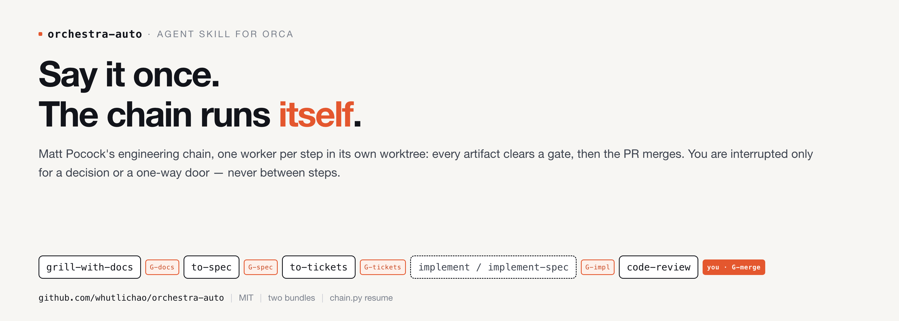
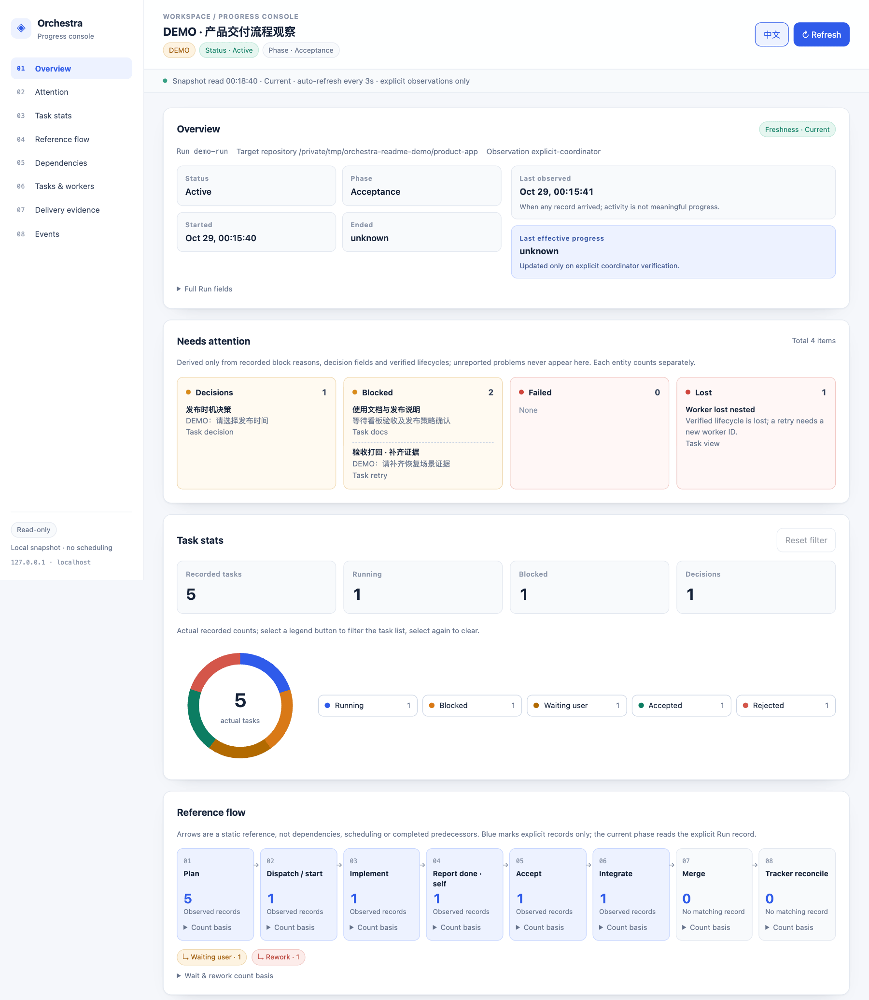
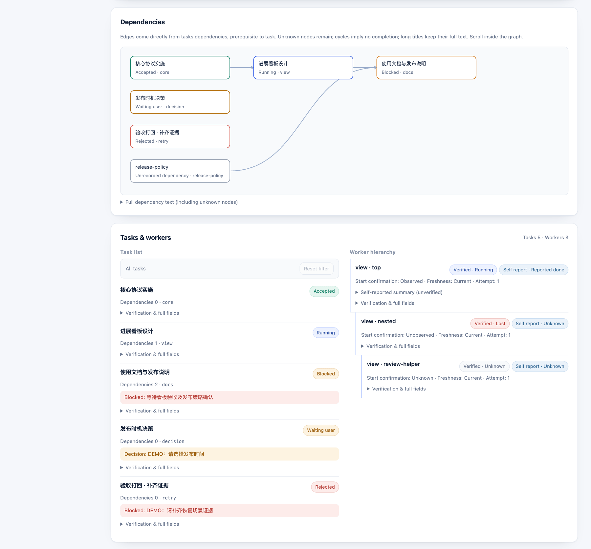

# orchestra-auto

**[English](README.md) · [简体中文](README.zh-CN.md)**

[](https://skills.sh/whutlichao/orchestra-auto) [](https://github.com/whutlichao/orchestra-auto/actions/workflows/tests.yml) [](./LICENSE)

An Agent Skill that runs [Matt Pocock's engineering chain](https://github.com/mattpocock/skills) on [Orca](https://www.onorca.dev/) as one continuous flow: you say what you want, a coordinator dispatches one worker per step into its own worktree, the step's artifact passes its gate, and the PR merges when you authorize it; a PR-only request stays open. You interrupt for a decision or a one-way door — not between steps.

The skills are his; this repository combines them into an opinionated Orca workflow with its own entry criteria and gates. It adds where the worker lands, what evidence is checked, when a merge is automatic, and when a human decides. `scripts/chain.py resume` and `scripts/chain.py exit-check` help inspect records and artifact shape, within the limits described below.



```bash
npx skills add whutlichao/orchestra-auto --skill orchestra-auto
```

Two installable variants carry the same practice in two languages. The command above installs the English one; the 简体中文 variant is `--skill orchestra-auto-zh` (see [Install](#install)). Chinese readers can start from [README.zh-CN.md](README.zh-CN.md). Matt Pocock has not worked on this repository or maintained it, and he does not endorse it.

## What it is

The planning route combines Matt Pocock's skills; the full sequence and its gates are this project's choices, not a mandatory upstream chain.

| Skill | What that step does |
| --- | --- |
| [`grill-me`](https://github.com/mattpocock/skills/blob/main/skills/productivity/grill-me/SKILL.md) | Runs `grilling` for an interactive interview without domain documentation |
| [`grill-with-docs`](https://github.com/mattpocock/skills/blob/main/skills/engineering/grill-with-docs/SKILL.md) | Interviews against the codebase until this change is sharp; terms go to the glossary, hard decisions to ADRs |
| [`wayfinder`](https://github.com/mattpocock/skills/blob/main/skills/engineering/wayfinder/SKILL.md) | Charts and works a dynamic decision map when planning is too large for one session and the path is unclear |
| [`to-spec`](https://github.com/mattpocock/skills/blob/main/skills/engineering/to-spec/SKILL.md) | Turns what is settled into a spec and publishes it to the issue tracker; it does not interview again |
| [`to-tickets`](https://github.com/mattpocock/skills/blob/main/skills/engineering/to-tickets/SKILL.md) | Splits a plan, spec or conversation into tickets with blocking edges — thin, complete tracer bullets |
| [`implement`](https://github.com/mattpocock/skills/blob/main/skills/engineering/implement/SKILL.md) | Builds one settled piece of work; drives `tdd` at the agreed seams and runs `code-review` before committing |
| [`implement-spec`](https://github.com/mattpocock/skills/blob/main/skills/engineering/implement-spec/SKILL.md) | Lands a whole spec on one integration branch; ready tickets run in parallel in their own worktrees, then `code-review` |

Enter at the step you already have. A single settled ticket uses `implement`; a complete map goes to one long-horizon `implement-spec` worker; a request for only design, a spec or tickets stops at that step's authorized delivery endpoint. `tdd` runs inside the ticket. When the request is too foggy to form a stable requirement, [`wayfinder`](https://github.com/mattpocock/skills/blob/main/skills/engineering/wayfinder/SKILL.md) lays out decision tickets first, and `to-spec` waits until the way is clear.

## How it runs

Orca wraps one loop around a step of the chain:

1. You say what you want.
2. The coordinator picks one step and dispatches one worker, which runs it in a new top-level worktree.
3. The ticket passes the gate for its type.
4. A decision or a one-way door comes back to you; otherwise the coordinator merges and syncs main when authorized; a PR-only request stays open.

The next step is another lap: another worker, another new worktree. The spec names the skill's absolute path on disk; if the spec does not say it, the worker does not do it.

### Between laps: resume and exit checks

A lap ends with a ledger record, so the next lap does not have to be reconstructed from the conversation:

```bash
python3 scripts/chain.py resume --run-id <run_id>          # where the chain continues, and why
python3 scripts/chain.py exit-check --step to-spec --artifact spec.md
python3 scripts/chain.py exit-check --step to-tickets --artifact tickets.md
```

`resume` reads the Run's ledger and returns the first position whose gate has no passed acceptance record — `grill`, `spec`, `tickets`, `build`, `review`. `implement` and `implement-spec` share that `build` position on purpose: both close on G-impl, and one record cannot tell them apart. `exit-check` applies the two artifact-shaped floors a spec or a ticket map has to clear before the next step consumes it — a `Test tier:` line and an acceptance section with a testable bullet; an acceptance line in every ticket. Everything else refuses, because the exit signal for those steps is a test run or a PR state and pretending to check it would be worse than declining.

Neither is a verdict. They catch a missing section, never a wrong decision; the gate stays with the coordinator. [chain-run.md](skills/orchestra-auto/references/chain-run.md) states what each may and may not conclude.

| | You invoke his skills yourself | orchestra-auto runs them on Orca |
| --- | --- | --- |
| Who advances the next step | You invoke them one by one | The coordinator dispatches one worker per round; the worker runs that one skill |
| Where the edit lands | The checkout the session is already in | Each task gets a new top-level worktree; an `implement-spec` implementer gets its own worktree and branch too |
| When a human appears | You stay in the session and keep moving | Decision-class questions come back to you: deliverable shape, approach forks, scope, credentials, third parties, payment, manual approval, irreversible live-data operations. You also merge a one-way Merge Danger door |
| How the work lands | However the target repo's tracker already does it | A project change opens a PR by default; when merge is authorized, the gates pass and the door is two-way, the coordinator merges and syncs main; a PR-only request stays open |

Bug fixes, research, triage, terminology and process errors still use his skills — `diagnosing-bugs`, `research`, `triage`, `domain-modeling` and `retro`. A retro's candidates are written outside the target repository, and a human selects one before a worker lands it. Dispatch flags, the inbox, send-backs and the breakers live in [SKILL.md](skills/orchestra-auto/SKILL.md).

Safety invariants:

- The coordinator plans, dispatches, answers and accepts. Edits, commits and the PR body for project files are done by the worker inside that ticket's worktree.
- `state: ready` only means the dispatch is ready. A started turn shows up as `turnStart: observed`, or as other evidence that agent supports.
- The worker's agent comes from Orca's current settings and stays off the current disabled list.
- Decision-class questions go to a human first. A worker's recommendation is reference only.
- The gate follows the ticket type. A design ticket does not run source tests; an implementation ticket does not skip its review. A small bounded change may skip the two-axis review when the reason is written into the spec and the Answer.
- An unusual diff is preserved before anyone reverts it. A failure is evidenced before anyone decides to re-dispatch.

## Install

| Skill | Language | Install |
| --- | --- | --- |
| [`orchestra-auto`](skills/orchestra-auto/SKILL.md) | English | `npx skills add whutlichao/orchestra-auto --skill orchestra-auto` |
| [`orchestra-auto-zh`](skills/orchestra-auto-zh/SKILL.md) | 简体中文 | `npx skills add whutlichao/orchestra-auto --skill orchestra-auto-zh` |

Both use the community [`skills` CLI](https://github.com/vercel-labs/skills). They are independent bundles, not a translation fallback, so installing both is fine.

```bash
# English
npx skills add whutlichao/orchestra-auto --skill orchestra-auto

# 简体中文
npx skills add whutlichao/orchestra-auto --skill orchestra-auto-zh
```

- Add `--global` for a user-wide install and `--agent <name>` to target specific agents: `npx skills add whutlichao/orchestra-auto --skill orchestra-auto --global --agent claude-code`.
- `orca skills install` only covers the skills in Orca's local registry, so it fails with `Unknown skill` for these packages — use `npx skills add` above.
- The command is the community CLI fetching a public GitHub repository; nothing is uploaded from your machine, and installing runs no code. This README makes no claim that the repository is already listed on skills.sh — per the [skills.sh FAQ](https://skills.sh/docs/faq), a listing is an observable consequence of real installs, not an author action. Telemetry is opt-out (`DISABLE_TELEMETRY=1`, `DO_NOT_TRACK=1`); nobody should install this to move a number.

> **Orca prerequisite.** Both skills drive the **Orca CLI** (`orca orchestration …`). They are not a general orchestration layer and do not work without Orca installed and its CLI reachable. See [Prerequisites and capability boundary](#prerequisites-and-capability-boundary) before installing.

## Prerequisites and capability boundary

| Requirement | Detail |
| --- | --- |
| Node.js and `npx` | The community `skills` CLI runs through `npx`. Nothing else here needs Node. |
| Orca | The [Orca](https://www.onorca.dev/) app with a reachable CLI. The skills call `orca orchestration worker-start`, `check`, `send`, `reply`, `worker-release` and friends. |
| Matt Pocock's engineering skills | The worker reads his skills, not a copy from this repository: `grill-with-docs`, `to-spec`, `to-tickets`, `implement`, `implement-spec`, plus the `tdd` and `code-review` they call. The spec names the absolute path. |
| Orca CLI executable | Use `ORCA_CLI_COMMAND` if set; otherwise `orca-dev` in a dev session, `orca-ide` on Linux outside an Orca-managed session, or `orca` elsewhere. Never fall back after failure. |
| The Orca `orchestration` guide | The skills fetch it with `orca skills get orchestration` and treat the live guide as authoritative over their own prose. |
| Worker agents | Whatever TUI agents your Orca profile has enabled. The skills read the current default and disabled list rather than naming one. |
| Python 3 | Used by the progress recorder/viewer (standard library only: POSIX file locks and `select`, so macOS/Linux/WSL). |

**Capability boundary.** The planning chain is Matt Pocock's; this repository does not redefine what those skills do. The orchestration verbs are Orca's. The judgements — channel selection, gate choice, decision classification — are transferable, but the *commands* are not portable, and the skill does not pretend they are. If your CLI does not expose `orca orchestration`, this skill is not for you.

Where a version-specific detail matters, the skills point at the **current** CLI help and the **current** Orca guide instead of hardcoding a value, and tell the coordinator to raise a question with evidence when its planned command does not match the public documentation.

## Verification

```bash
python3 -m unittest discover -s tests -v
```

The exit status is the answer. The suite needs no network, credentials or particular machine, and it runs every module under `tests/`:

- `tests/test_inbox_loop.py` models the 1.4.248 message contract and checks that retired entrypoints preserve old state and do not consume mail, plus retry, deduplication and inbox recovery.
- `tests/test_progress_dashboard.py` covers the progress CLI and the localhost dashboard: snapshot and registry contracts, the singleton startup lock, protocol compatibility, fallbacks, Run isolation, the read-only HTTP surface and the `serve --state` DEMO path.
- `tests/test_chain.py` covers chain-level resume and the two artifact floors: which acceptance records land a position, why a gap earlier in the chain wins, and what an exit check refuses to judge.
- `tests/test_ledger.py`, `test_preflight.py`, `test_health.py`, `test_acceptance.py` and `test_closeout.py` cover the stability modules through their declared seams.
- `tests/test_package_content.py` checks the package itself: parity between the language variants, frontmatter, every relative link, references and their triggers, eval shape, `py_compile`, `bash -n`, the MIT licence and the leak scan. Its prose-contract suite pins the decisions the documents used to get wrong; the anchor test **checks anchors, not full semantic equivalence**, so the two-axis review still reads the diff.

### Scenario checks

Each language variant ships `evals/evals.json` with **38 prompt-level scenarios** covering channel routing, worker-slot resolution, start verification, gate choice, review arrangement, send-back judgement, decision classification, escalation, merge exceptions and the native wake and recovery contract. The last seven cover the stability workstreams; crash-window reconciliation is one scenario naming W1/W2/W3, so the total is 31 + 7 = 38. These are scenario checks, not end-to-end proof: they show whether an agent reasons the way the skill intends, not whether orchestration works against a live Orca host.

### Entrypoint size and activation cost

A host injects the full `SKILL.md` when the skill activates; `references/` is read only when the routing table points to it. [PR #2](https://github.com/whutlichao/orchestra-auto/pull/2) moved dispatch-loop and reply detail into references. Compared with pre-thin commit `fbb09b9`:

| Variant | `SKILL.md` bytes | Approx. tokens (bytes ÷ 4) |
| --- | ---: | ---: |
| English | 30,208 → 24,130 (−20.1%) | 7,552 → 6,032 |
| Chinese | 24,359 → 21,748 (−10.7%) | 6,089 → 5,437 |

A test recomputes the right-hand values from the bundle, so the table cannot drift. The token figures are **bytes ÷ 4**, not a tokenizer measurement. If a turn loads both new references, activation savings are not whole-turn savings.

### Automated disclosure scan

`LeakScanTests` in `tests/test_package_content.py` scans every published text file for home-directory paths, a profile database filename, credential-style variable names, token literals and internal Run/Task/Dispatch/message identifiers. The scanner holds generic *shapes*, never the private literals; exact values are checked out of band with `PRIVATE_IDENTIFIERS=<a,b,c> python3 -m unittest tests.test_package_content`, which skips without the variable. Exceptions are granted per (file, pattern) pair, and only the scanner's own source may exempt itself. Two manual checks remain: read your own diff before pushing, and confirm the copyright holder appears only in `LICENSE`, both READMEs and the launch kit.

## Local progress dashboard

The dashboard is a non-blocking, read-only sidecar: Python 3 standard library, no database, external service or credentials. The coordinator records sanitized Run/task/worker facts; it does not poll Orca or consume inbox messages. Worker self-reports stay separate from verification, and implemented, integrated, merged and tracker_closed are independent, initially unverified facts.

**When it starts**: before the first dispatch of every real orchestration Run, the coordinator initializes a progress record in a new directory outside the repository and runs `open`. One read-only service runs per user under `$ORCA_PROGRESS_HOME` (default `~/.orca/progress`): `open` registers the Run, starts the service only when none is running or the recorded one is refused, tries the default browser, and prints `{url, pid, degraded, reason, browser_opened}` as JSON. If the browser cannot open, the URL must be opened manually; a degraded result also warns and never blocks dispatch. If startup or recording fails, it warns and the Run continues — the dashboard never blocks dispatch, questions, acceptance or the native message channel.

The page shows a Run overview, attention items, task-count donut charts, the reference workflow, the dependency graph, tasks and workers, delivery evidence and events. Delivery booleans stay independent; no predecessor success is inferred. Chinese/English switching, filters, expanded details and graph scroll survive refresh.

The screenshots below are a local **DEMO** run with illustrative data only — no real repository or personal paths. The page labels itself **DEMO**.





From this repository, reproduce the offline demo with an `AUDIT_ROOT` outside every repository (DEMO and REAL use separate new directories):

```bash
python3 skills/orchestra-auto/scripts/progress-demo.py --state "$AUDIT_ROOT/demo-example" --target-repo "$PWD"
python3 skills/orchestra-auto/scripts/progress.py --state "$AUDIT_ROOT/demo-example" serve --port 8766
```

Open **http://127.0.0.1:8766/**. The demo uses an explicit `serve`, which prints an address and never opens a browser. For **REAL** recording, initialize a separate directory and use `open`, the automatic first-dispatch path:

```bash
python3 skills/orchestra-auto/scripts/progress.py --state "$AUDIT_ROOT/run-example" init \
  --event-id init-1 --data "{\"id\":\"run-example\",\"target_repo\":\"$PWD\",\"mode\":\"REAL\",\"status\":\"active\"}" \
  || printf '%s\n' 'Progress warning; continue orchestration' >&2
python3 skills/orchestra-auto/scripts/progress.py --state "$AUDIT_ROOT/run-example" open \
  || printf '%s\n' 'Progress warning; continue orchestration' >&2
```

The singleton exposes three read-only GET routes on `127.0.0.1`: `/health` (service plus registered Run IDs, labels and projected `run_states`), `/?run=<id>` (the page, listing every registered Run in a top bar dropdown) and `/snapshot?run=<id>`. Cross-Run access is limited to that list; responses name Run IDs, never state paths; an unreadable Run shows as unavailable and is never deleted by the service or `open`. Only an explicit `registry prune` archives ended Runs into `archive/` and removes their descriptors. Every response is GET-only with a CSP, `Cache-Control: no-store` and `X-Content-Type-Options: nosniff`, and the `Host` header must be `localhost` or `127.0.0.1`. JSON commands, recovery and the exact checkpoints are in the [protocol and workflow ownership](skills/orchestra-auto/references/progress-dashboard.md).

## Repository layout

```text
.
├── LICENSE                     MIT, copyright 2026 whutlichao
├── CONTRIBUTING.md             how to change the packages
├── SECURITY.md                 what counts as a security issue here
├── README.md                   this file
├── README.zh-CN.md             中文说明
├── skills.sh.json              skills.sh directory grouping
├── skills/
│   ├── orchestra-auto/         English bundle; references/ holds eighteen files
│   └── orchestra-auto-zh/      Chinese bundle, same structure
├── launch-kit/                 positioning, demo script, FAQs, channel drafts
└── tests/                      the unittest suites above
```

## Status and scope

- The workflow is opinionated about **how Matt Pocock's skills run on Orca**, not about your product: it will not decide what to build, and it escalates rather than guessing.
- The launch materials under `launch-kit/` are **drafts**. They exist so a maintainer can post them deliberately, after review. Preparing them involves no account sign-in, no community contact and no posting.
- This repository holds the published packages, their checks and their documentation. It does not contain Orca itself.

## Open question

Where the procedure is least settled, written down so it can be argued with rather than re-litigated each time: **[the four acceptance levels — where do they break?](https://github.com/whutlichao/orchestra-auto/issues/20)** (implemented / integrated / merged / tracker-closed). The cases I expect to be wrong are a ticket spanning two PRs, a tracker that closes itself from a merge keyword, work that is deliberately never merged, and a revert after merge. A concrete scenario is worth more than an opinion — that is where a fix actually lands.

## Acknowledgments

The planning chain is [Matt Pocock's public engineering skills](https://github.com/mattpocock/skills). This repository is the supervised way to run those skills on Orca (`orca orchestration`), and it is this repository's own work. Matt Pocock has not participated in its development or maintenance and does not endorse it. See [Matt Pocock's GitHub profile](https://github.com/mattpocock).

## Contributors

- **[@dxnnystyles](https://github.com/dxnnystyles)** — closeout reads the latest acceptance attempt per ticket, and two records at the same attempt that disagree about the merge SHA are now treated as divergent rather than as one claim ([PR #49](https://github.com/whutlichao/orchestra-auto/pull/49)).

## Licence

[MIT](LICENSE), copyright 2026 whutlichao. Contributions are welcome; see [CONTRIBUTING.md](CONTRIBUTING.md).
