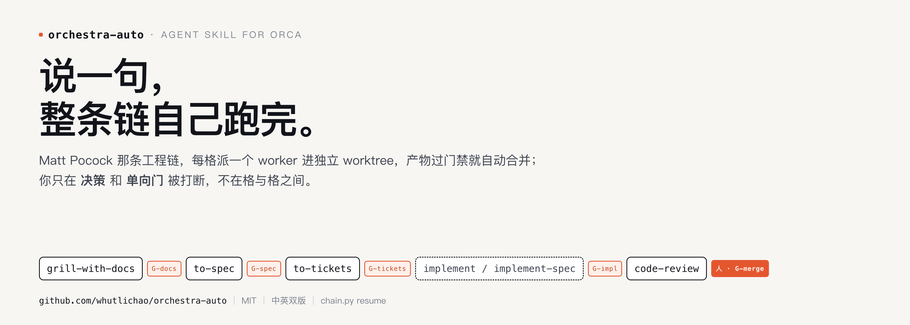
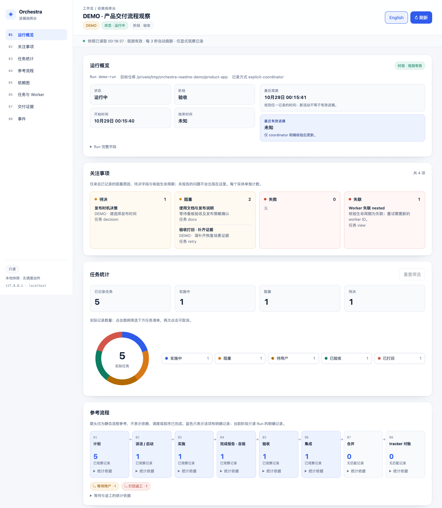
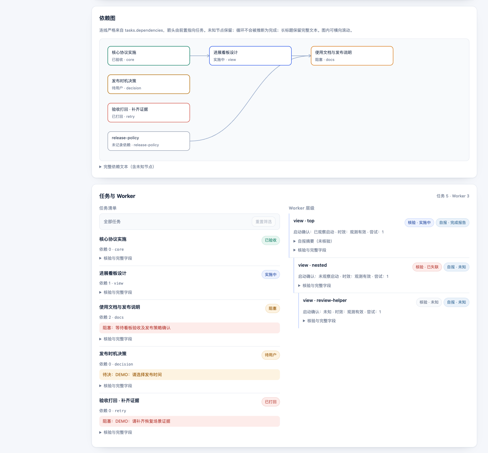

# orchestra-auto

**[English](README.md) · [简体中文](README.zh-CN.md)**

[](https://skills.sh/whutlichao/orchestra-auto) [](https://github.com/whutlichao/orchestra-auto/actions/workflows/tests.yml) [](./LICENSE)

这是一套把 [Matt Pocock 的工程 skill 链](https://github.com/mattpocock/skills) 放到 [Orca](https://www.onorca.dev/) 上**整条跑完**的 Agent Skill：你说一句要什么，coordinator 按格派 worker、每格落独立 worktree、产物过门禁，在获授权时合并 PR；只要求开 PR 时保留开放状态。你只在需要决定和单向门上被打断，不是在格与格之间。

链是他的，一格没改。这个仓库补的是「一条链要在 Orca 上无人值守跑下去」所需的那些东西：下一格是哪格、worker 落在哪、产物进入下一格前必须带什么、什么时候合并是自动的、人必须在哪里插进来。其中两件事现在由命令回答，而不靠记忆：`scripts/chain.py resume` 和 `scripts/chain.py exit-check`。



```bash
npx skills add whutlichao/orchestra-auto --skill orchestra-auto
```

两个可安装变体、同一套跑法、两种语言。上面这条装英文版；简体中文版是 `--skill orchestra-auto-zh`（见 [安装](#安装)）。英文说明见 [README.md](README.md)。Matt Pocock 没有参与本仓库的开发或维护，也没有为本仓库背书。

## 这是什么

规划链是 Matt Pocock 的，保持他发布的顺序。本仓库只写每一格在 Orca 里怎么跑：谁调用、worker 落在哪个 worktree、什么时候自动合并、什么时候问人。

| Skill | 这一格做什么 |
| --- | --- |
| [`grill-with-docs`](https://github.com/mattpocock/skills/blob/main/skills/engineering/grill-with-docs/SKILL.md) | 对着代码库追问，直到这次改动说清；术语进术语表，难解释的决定进 ADR |
| [`to-spec`](https://github.com/mattpocock/skills/blob/main/skills/engineering/to-spec/SKILL.md) | 把已经说清的内容收成 spec 并发到 issue tracker；这一格不再追问 |
| [`to-tickets`](https://github.com/mattpocock/skills/blob/main/skills/engineering/to-tickets/SKILL.md) | 把计划、spec 或对话拆成带阻塞关系的票——细而完整、能单独演示的 tracer bullet |
| [`implement`](https://github.com/mattpocock/skills/blob/main/skills/engineering/implement/SKILL.md) | 做一块已经说清的工作；按约定的 seam 走 `tdd`，提交前跑 `code-review` |
| [`implement-spec`](https://github.com/mattpocock/skills/blob/main/skills/engineering/implement-spec/SKILL.md) | 把整份 spec 落在一条 integration branch 上；就绪的票在各自 worktree 并行做，结束前跑 `code-review` |

已有 spec 或已有票，就从对应的那一格进入。一张定案的票用 `implement`；整张票图交给一个长程 `implement-spec` worker；只要设计、规格或拆票，则到那一格的授权交付终点就停。`tdd` 在票内调用。需求还散、形不成稳定需求时，先用 [`wayfinder`](https://github.com/mattpocock/skills/blob/main/skills/engineering/wayfinder/SKILL.md) 铺开决策票，路清了再进 `to-spec`。

## 怎么跑

Orca 在链的每一格外包一圈循环：

1. 你说清要做什么。
2. coordinator 选一格，派一个 worker；worker 在新的顶层 worktree 里执行它。
3. 票按类型过门禁。
4. 决策或单向门回到你这里；否则在用户授权合并时 coordinator 合并 PR 并同步 main；只要求开 PR 时止于开放 PR。

下一格是下一次同样的循环：再派一个 worker，再开一个新 worktree。spec 里写这个 skill 在本机的绝对路径；spec 里没写的，worker 不会做。

### 两轮之间：续跑与出口检查

每轮结束都留一条台账记录，所以下一轮不必从对话里重建：

```bash
python3 scripts/chain.py resume --run-id <run_id>          # 链条从哪个位置继续，以及为什么
python3 scripts/chain.py exit-check --step to-spec --artifact spec.md
python3 scripts/chain.py exit-check --step to-tickets --artifact tickets.md
```

`resume` 读这次 Run 的台账，返回第一个「门禁还没有通过的验收记录」的位置——`grill`、`spec`、`tickets`、`build`、`review`。`implement` 和 `implement-spec` 故意共用 `build` 这个位置：两者都关在 G-impl 上，一条记录分不出是哪一个。`exit-check` 施加两道产物地板：spec 要有 `Test tier:` 行和带可验收条目的验收小节，票图里每一张票都要有验收行。其余步骤直接拒绝——它们的出口信号是测试运行或 PR 状态，假装检查比直说不查更糟。

两者都不是判决。它们只抓缺失的小节，抓不住错误的决定；门禁仍然归 coordinator。[chain-run.md](skills/orchestra-auto-zh/references/chain-run.md) 写明各自能推出什么、不能推出什么。

| | 你自己调用他的 skill | 用 orchestra-auto 在 Orca 上跑 |
| --- | --- | --- |
| 谁推进下一格 | 你逐条调用 | coordinator 每轮派一个 worker，worker 执行那一个 skill |
| 改动落在哪 | 当前会话所在的检出 | 每个任务一个新的顶层 worktree；`implement-spec` 的 implementer 也各有自己的 worktree 和分支 |
| 人什么时候出面 | 你留在会话里往下推进 | 决策类问题要问你：交付形态、方案分叉、范围，以及凭证、第三方、付费、人工审批、不可逆的 live 数据操作。单向 Merge Danger 门也由你合并 |
| 怎么落地 | 按目标仓库的 tracker 习惯 | 项目改动默认开 PR；用户授权合并且门禁通过并为双向门时，coordinator 合并并同步 main；只要求开 PR 则保持开放 |

修 bug、研究、外部 issue 分流、术语对齐和流程出错仍用他的 skill——`diagnosing-bugs`、`research`、`triage`、`domain-modeling` 和 `retro`。retro 的候选写在目标仓库外，人选定之后才由 worker 落地。派活参数、收件、打回和熔断写在 [SKILL.md](skills/orchestra-auto-zh/SKILL.md)。

安全不变量：

- coordinator 只做规划、派活、应答和验收。项目文件的修改、提交和 PR 正文由 worker 在该票的 worktree 里完成。
- `state: ready` 只说明 dispatch 就绪。turn 是否开始，看 `turnStart: observed`，或该 agent 实际支持的证据。
- worker 用的 agent 来自 Orca 当前设置，并避开当前禁用列表。
- 决策类问题先问人。worker 给出的推荐只作参考。
- 门禁按票型选。设计票不跑源码测试，实施票不跳过自己的 review。可圈定的小改动可以省略双轴 review，理由写进 spec 和 Answer。
- 异常 diff 先留证。失败先取证，再决定要不要重派。

## 安装

| Skill | 语言 | 安装 |
| --- | --- | --- |
| [`orchestra-auto`](skills/orchestra-auto/SKILL.md) | English | `npx skills add whutlichao/orchestra-auto --skill orchestra-auto` |
| [`orchestra-auto-zh`](skills/orchestra-auto-zh/SKILL.md) | 简体中文 | `npx skills add whutlichao/orchestra-auto --skill orchestra-auto-zh` |

两个 skill 都用社区 [`skills` CLI](https://github.com/vercel-labs/skills) 安装。它们是两个独立包，不是互备的翻译兜底，团队双语的话两个都装也可以。

```bash
# English
npx skills add whutlichao/orchestra-auto --skill orchestra-auto

# 简体中文
npx skills add whutlichao/orchestra-auto --skill orchestra-auto-zh
```

- 加 `--global` 装到用户级，加 `--agent <name>` 指定目标 agent：`npx skills add whutlichao/orchestra-auto --skill orchestra-auto --global --agent claude-code`。
- `orca skills install` 只覆盖 Orca 本地注册表里的 skill，对这两个包会报 `Unknown skill`——请用上面的 `npx skills add`。
- 这条命令是社区 CLI 去拉一个公开的 GitHub 仓库；不会上传你机器上的东西，安装本身不执行代码。本 README 不声称本仓库已收录在 skills.sh 上——按 [skills.sh FAQ](https://skills.sh/docs/faq)，收录是真实安装带来的可观察结果，不是作者提交的动作。遥测可退出（`DISABLE_TELEMETRY=1`、`DO_NOT_TRACK=1`）；不要为了刷数字去安装。

> **Orca 专用前提。** 两个 skill 都驱动 **Orca CLI**（`orca orchestration …`）。它们不是通用的 agent 编排层，未安装 Orca 或 CLI 不可达时无法工作。安装前请先读 [前提与能力边界](#前提与能力边界)。

## 前提与能力边界

| 要求 | 说明 |
| --- | --- |
| Node.js 与 `npx` | 社区 `skills` CLI 通过 `npx` 运行。除此之外本仓库不需要 Node。 |
| Orca | 已安装 [Orca](https://www.onorca.dev/) 且 CLI 可达。skill 会调用 `orca orchestration worker-start`、`check`、`send`、`reply`、`worker-release` 等。 |
| Matt Pocock 的工程 skill | worker 要读到的是他的 skill，不是本仓库的副本：`grill-with-docs`、`to-spec`、`to-tickets`、`implement`、`implement-spec`，以及它们调用的 `tdd` 和 `code-review`。spec 里写绝对路径。 |
| Orca CLI 可执行文件 | `ORCA_CLI_COMMAND` 优先；否则开发会话用 `orca-dev`，Linux 非 Orca 管理会话用 `orca-ide`，其余用 `orca`；失败不回退。 |
| Orca 的 `orchestration` 指南 | skill 用 `orca skills get orchestration` 取回它，并以**实时**指南为准，而不是以 skill 自己的叙述为准。 |
| worker agent | 你的 Orca profile 已启用的那些 TUI agent。skill 读取当前默认值与当前禁用列表，而不是写死某一个。 |
| Python 3 | 进度记录/看板会用到（只用标准库：POSIX 文件锁与 `select`，故限 macOS/Linux/WSL）。 |

**能力边界。** 规划链是 Matt Pocock 的，本仓库不重新定义那些 skill 做什么。编排动词是 Orca 的。其中的判断——通道选择、门禁选择、决策分类——可以迁移，但*命令*不可移植，skill 也不会假装它可以。如果你的 CLI 不提供 `orca orchestration`，这个 skill 不适合你。

凡是版本相关细节，skill 指向**当前** CLI help 与**当前** Orca 指南，而不是写死某个值；并明确要求 coordinator 在计划用的命令与公开文档不一致时，带证据提问，而不是猜。

## 验证

```bash
python3 -m unittest discover -s tests -v
```

退出码即结论。套件不联网、不需要凭证、不依赖任何特定机器，会跑 `tests/` 下的每个模块：

- `tests/test_inbox_loop.py` 使用模拟的 1.4.248 消息契约，验证已退役入口不消费消息或修改历史状态，以及 retry、去重和 inbox 恢复。
- `tests/test_progress_dashboard.py` 覆盖进度 CLI 与 localhost 看板：snapshot 与注册表契约、单例启动锁、协议兼容、回退、Run 隔离、只读 HTTP 表面与 `serve --state` 的 DEMO 路径。
- `tests/test_chain.py` 覆盖链级续跑与两道产物地板：哪些验收记录能让一个位置落地、为什么链条更早的缺口优先、以及出口检查拒绝判断什么。
- `tests/test_ledger.py`、`test_preflight.py`、`test_health.py`、`test_acceptance.py` 与 `test_closeout.py` 通过各自声明的缝覆盖稳定性模块。
- `tests/test_package_content.py` 检查包本身：两个语言变体结构一致、frontmatter、所有相对链接、reference 及其触发条件、eval 形状、`py_compile`、`bash -n`、MIT 许可与脱敏扫描。其中的散文契约回归钉住文档过去判错的决定；锚点测试**只查锚点，不等于完整语义等价**，所以双轴 review 仍要读 diff。

### 场景检查

每个语言变体都带 `evals/evals.json`，**38 个提示词层面的场景**，覆盖通道判定、worker 栏取值、启动确认、门禁选择、review 安排、打回判断、决策分类、升级、合并例外，以及原生唤醒与恢复契约。最后七个覆盖稳定性工作流；崩溃窗口对账是一个场景，同时点名 W1/W2/W3，因此总数是 31 + 7 = 38。这些是场景检查，不是端到端证明：它们看的是 agent 是否按 skill 的意图推理，不证明编排在真实 Orca 主机上能跑通。

### 入口体积与激活成本

skill 激活时宿主注入完整的 `SKILL.md`；只有路由表指向时，才读取 `references/`。[PR #2](https://github.com/whutlichao/orchestra-auto/pull/2) 把派发循环与回复细节移进了 references。与精简前的提交 `fbb09b9` 相比：

| 变体 | `SKILL.md` 字节数 | 估算 token（字节 ÷ 4） |
| --- | ---: | ---: |
| 英文 | 30,208 → 22,663（−25.0%） | 7,552 → 5,665 |
| 中文 | 24,359 → 19,739（−19.0%） | 6,089 → 4,934 |

右列由测试从包本身重算，所以这张表不会漂移。token 口径是**字节数 ÷ 4**，不是 tokenizer 实测。如果某一轮同时读取两个新 reference，激活时的节省不等于整轮的节省。

### 自动脱敏扫描

`tests/test_package_content.py` 里的 `LeakScanTests` 扫描每个已发布文本文件，找主目录绝对路径、某个具体的 profile 数据库文件名、凭证类变量名、token 字面量，以及内部 Run/Task/Dispatch/message 标识。扫描器只持有通用**形态**，绝不写私有字面量；精确值走带外核验：`PRIVATE_IDENTIFIERS=<a,b,c> python3 -m unittest tests.test_package_content`，没有这个变量时该用例 skip。每条例外按（文件，模式）对授予，只有扫描器自身源码可以自我豁免。另有两项人工检查：push 前自己读一遍 diff；核对版权人只出现在 `LICENSE`、两个 README 与 launch kit。

## 本地进度看板

看板是不阻塞编排的只读旁路：仅依赖 Python 3 标准库，无数据库、外部服务或凭证。coordinator 显式记录去敏 Run/task/worker 事实，不查询 Orca，不消费 inbox 消息。worker 自报与验证分开，implemented、integrated、merged、tracker_closed 四项独立，初始为未确认。

**何时启动**：每个实际编排 Run 首次派活前，coordinator 在仓库外的新目录初始化进度记录并执行 `open`。每用户只有一个只读服务，位于 `$ORCA_PROGRESS_HOME`（默认 `~/.orca/progress`）：`open` 注册 Run，仅在无服务或记录中的服务被拒绝时启动它，尝试打开默认浏览器，并以 JSON 输出 `{url, pid, degraded, reason, browser_opened}`。浏览器无法打开时，用户需按输出的 URL 手动访问；降级结果同样只警告，绝不阻断派发。启动或记录失败也只警告，Run 继续——看板从不阻断派活、问答、验收或原生消息通道。

页面展示运行概览、关注事项、任务数量环图、参考流程、依赖图、任务与 Worker、交付证据及事件。交付布尔值保持独立，不从后续步骤推断前序成功。中文/English、筛选、展开明细和依赖图滚动位置在刷新后保留。

下面两图是本地 **DEMO** 运行，全部为示例数据，不含真实仓库路径与个人信息，页面自身标注 **DEMO**。





在本仓库运行（或改为安装包脚本路径），用所有仓库之外的 `AUDIT_ROOT` 复现离线演示（DEMO 与 REAL 使用不同的新目录）：

```bash
python3 skills/orchestra-auto-zh/scripts/progress-demo.py --state "$AUDIT_ROOT/demo-example" --target-repo "$PWD"
python3 skills/orchestra-auto-zh/scripts/progress.py --state "$AUDIT_ROOT/demo-example" serve --port 8766
```

打开 **http://127.0.0.1:8766/**。DEMO 用显式 `serve`，只打印地址、不打开浏览器。**REAL** 记录先初始化独立目录，再用 `open`——这是首次派活前的自动路径：

```bash
python3 skills/orchestra-auto-zh/scripts/progress.py --state "$AUDIT_ROOT/run-example" init \
  --event-id init-1 --data "{\"id\":\"run-example\",\"target_repo\":\"$PWD\",\"mode\":\"REAL\",\"status\":\"active\"}" \
  || printf '%s\n' 'Progress warning; continue orchestration' >&2
python3 skills/orchestra-auto-zh/scripts/progress.py --state "$AUDIT_ROOT/run-example" open \
  || printf '%s\n' 'Progress warning; continue orchestration' >&2
```

单例服务只在 `127.0.0.1` 上暴露三条只读 GET 路由：`/health`（服务状态、已注册 Run ID、标签与投影 `run_states`）、`/?run=<id>`（页面，在顶栏右侧下拉列出所有已注册 Run）与 `/snapshot?run=<id>`。跨 Run 访问仅限该列表；响应只出现 Run ID，绝不出现状态路径；不可读的 Run 标为不可用，服务与 `open` 绝不删除。只有显式 `registry prune` 会归档已结束 Run 到 `archive/` 并移除其描述符。所有响应只支持 GET，并带 CSP、`Cache-Control: no-store` 与 `X-Content-Type-Options: nosniff`，`Host` 头必须是 `localhost` 或 `127.0.0.1`。完整 JSON 命令、恢复与各节点责任见[协议与流程责任](skills/orchestra-auto-zh/references/progress-dashboard.md)。

## 仓库结构

```text
.
├── LICENSE                     MIT，版权 2026 whutlichao
├── CONTRIBUTING.md             如何改动这些包
├── SECURITY.md                 什么算这里的安全问题
├── README.md                   English README
├── README.zh-CN.md             本文件
├── skills.sh.json              skills.sh 目录页的分组配置
├── skills/
│   ├── orchestra-auto/         英文包；references/ 有 18 个文件
│   └── orchestra-auto-zh/      中文包，结构相同
├── launch-kit/                 定位、demo 讲稿、FAQ、各渠道草稿
└── tests/                      上面的 unittest 套件
```

## 状态与范围

- 这套流程主张的是 **Matt Pocock 的 skill 在 Orca 上怎么跑**，不替你决定产品做什么。拿不准就升级，而不是猜。
- `launch-kit/` 下的发布材料是**草稿**。它们存在的意义是让维护者在审阅后自己发出去。准备这些材料不涉及登录账号、不接触社区、不代为发帖。
- 本仓库只放已发布的包、它们的检查与文档，不含 Orca 本身。

## 待议问题

流程里最没把握的一处，写在这儿是为了能被反驳，而不是每次重新吵一遍：**[验收的四级——它们在哪会出错？](https://github.com/whutlichao/orchestra-auto/issues/20)**（implemented / integrated / merged / tracker-closed）。我预计会错的情况有四种：一张票跨两个 PR、tracker 靠 merge 关键字自动关票、刻意永不合并的探索性工作、以及合并后又 revert。具体场景比观点有用——改动最终落在评测场景里。

## 致谢

规划链用的是 [Matt Pocock 公开的工程 skill](https://github.com/mattpocock/skills)。本仓库写的是这些 skill 在 Orca（`orca orchestration`）上的监督式跑法，由本仓库实现。Matt Pocock 没有参与开发或维护，也没有背书。个人资料见 [github.com/mattpocock](https://github.com/mattpocock)。

## 许可

[MIT](LICENSE)，版权 2026 whutlichao。欢迎贡献，见 [CONTRIBUTING.md](CONTRIBUTING.md)。
