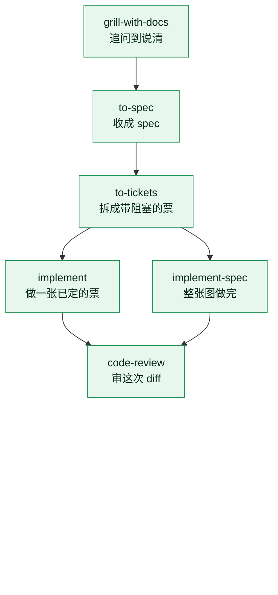
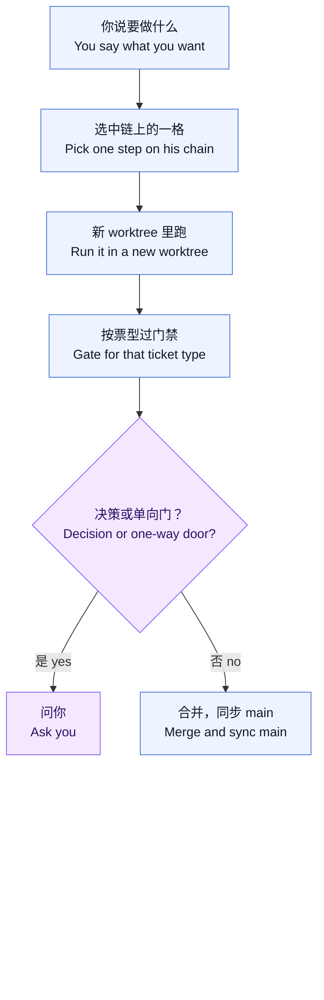

# orchestra-auto

**[English](README.md) · [简体中文](README.zh-CN.md)**

[](https://skills.sh/whutlichao/orchestra-auto) [](#验证) [](./LICENSE)

这是一份 Orca 最佳实践，整个做法围绕 [Matt Pocock 的工程 skill](https://github.com/mattpocock/skills)。链用他的。监督、隔离、门禁和合并用 [Orca](https://www.onorca.dev/)。

派活容易，最后 20% 才难——supervised Orca 编排 skills。

<video src="https://github.com/user-attachments/assets/c375a505-a7eb-436a-89d3-e08bce5f16f6" controls width="720" poster="docs/demo/orchestra-auto-poster.jpg"></video>

[观看演示视频（MP4）](https://github.com/user-attachments/assets/c375a505-a7eb-436a-89d3-e08bce5f16f6)

```bash
npx skills add whutlichao/orchestra-auto --skill orchestra-auto
```

本仓库发布**两个可安装的 Agent Skill**，同一套跑法、两种语言。上面这条装的是英文版；简体中文版是
`--skill orchestra-auto-zh`（见 [安装](#安装)）。英文说明见 [README.md](README.md)。

Matt Pocock 没有参与本仓库的开发或维护，也没有为本仓库背书。

## 链是他的

主链保持他发布的顺序：`grill-with-docs` → `to-spec` → `to-tickets`，然后 `implement` 或 `implement-spec`，结束时 `code-review`。这些 skill 的正文以他的仓库为准。本仓库只写每一格在 Orca 里怎么跑：谁调用、worker 落在哪个 worktree、什么情况下合并、什么情况下问人。

| Skill | 这一格做什么 |
| --- | --- |
| [`grill-with-docs`](https://github.com/mattpocock/skills/blob/main/skills/engineering/grill-with-docs/SKILL.md) | 对着代码库追问，直到这一次改动说清。术语写入术语表，难解释的决定写成 ADR |
| [`to-spec`](https://github.com/mattpocock/skills/blob/main/skills/engineering/to-spec/SKILL.md) | 把已经说清的内容收成 spec，发到 issue tracker。这一格不再追问 |
| [`to-tickets`](https://github.com/mattpocock/skills/blob/main/skills/engineering/to-tickets/SKILL.md) | 把计划、spec 或当前对话拆成票。每张票写明阻塞关系。他称这种票为 tracer bullet：细而完整，落地就能单独演示 |
| [`implement`](https://github.com/mattpocock/skills/blob/main/skills/engineering/implement/SKILL.md) | 做一块已经说清的工作。按约定的 seam 走 `tdd`，提交前跑 `code-review` |
| [`implement-spec`](https://github.com/mattpocock/skills/blob/main/skills/engineering/implement-spec/SKILL.md) | 把整份 spec 做完，落在一条 integration branch 上。票是任务图，就绪的票在各自 worktree 里并行做，结束前跑 `code-review` |

已有 spec 或已有票，就从对应的那一格进入。一张已经定案的票用 `implement`。整张票图只派一个长程 `implement-spec` worker。只要设计、只要规格或只要拆票，那一格的 PR 合并后停止。



`tdd` 由 `implement` 和 `implement-spec` 在票内调用。需求还散、形不成稳定需求时，先用他的 [`wayfinder`](https://github.com/mattpocock/skills/blob/main/skills/engineering/wayfinder/SKILL.md) 把决策票铺开，路清了再进入 `to-spec`。

## 跑法变在哪

上图每一格的名字不变。变的是往前走一格时，谁动手、动在哪、人要不要出面。

| | 你自己调用他的 skill | 用 orchestra-auto 在 Orca 上跑 |
| --- | --- | --- |
| 谁推进下一格 | 你逐条调用 | coordinator 按本轮请求派一个 worker，worker 执行那一个 skill |
| 改动落在哪 | 当前会话所在的检出 | 每个任务一个新的顶层 worktree。`implement-spec` 的 implementer 再各有自己的 worktree 和分支。coordinator 不在这些 worktree 里改文件 |
| 人什么时候出面 | 你留在会话里往下推进 | 开头说清要做什么。决策类问题要问你：交付形态、方案分叉、范围，以及凭证、第三方、付费、人工审批、不可逆的 live 数据操作。单向 Merge Danger 门也由你合并 |
| 怎么落地 | 按目标仓库的 tracker 习惯 | 项目改动默认开 PR。门禁通过并且是双向门，coordinator 合并并同步 main |



链还要往下走时，下一格是下一次同样的循环：再派一个 worker，再开一个新的顶层 worktree。单向门留在「问你」这一支。spec 里写这个 skill 在本机的绝对路径。spec 里没写的，worker 不会做。

下面这些情况仍用他的 skill：

| 情况 | skill |
| --- | --- |
| 修 bug | [`diagnosing-bugs`](https://github.com/mattpocock/skills/blob/main/skills/engineering/diagnosing-bugs/SKILL.md)，然后 `implement` |
| 必须落盘的研究 | [`research`](https://github.com/mattpocock/skills/blob/main/skills/engineering/research/SKILL.md) |
| 外部 issue | [`triage`](https://github.com/mattpocock/skills/blob/main/skills/engineering/triage/SKILL.md) |
| 术语没对齐 | [`domain-modeling`](https://github.com/mattpocock/skills/blob/main/skills/engineering/domain-modeling/SKILL.md) |
| 流程出错，不是产品 bug | [`retro`](https://github.com/mattpocock/skills/blob/main/skills/engineering/retro/SKILL.md)。候选写在目标仓库外，人选定之后才由 worker 落地 |

Orca 上多出来的约束：

- coordinator 做规划、派活、应答和验收。项目文件的修改、提交和 PR 正文由 worker 在该票的 worktree 里完成。
- `state: ready` 只说明 dispatch 就绪。turn 是否开始，看 `turnStart: observed`，或该 agent 实际支持的证据。
- worker 用的 agent 来自 Orca 当前设置，并避开当前禁用列表。
- 决策类问题先问人。worker 给出的推荐只作参考。
- 门禁按票型选。设计票不跑源码测试，实施票不跳过自己的 review。可圈定的小改动可以省略双轴 review，理由写进 spec 和 Answer。
- 异常 diff 先留证。失败先取证，再决定要不要重派。

派活参数、收件、打回和熔断写在 [SKILL.md](skills/orchestra-auto-zh/SKILL.md)。上面两张图只保留他的链，以及这条链被 Orca 接住之后的那一圈。

## 安装

本仓库发布**两个可安装的 Agent Skill**，同一套跑法、两种语言：

| Skill | 语言 | 安装 |
| --- | --- | --- |
| [`orchestra-auto`](skills/orchestra-auto/SKILL.md) | English | `npx skills add whutlichao/orchestra-auto --skill orchestra-auto` |
| [`orchestra-auto-zh`](skills/orchestra-auto-zh/SKILL.md) | 简体中文 | `npx skills add whutlichao/orchestra-auto --skill orchestra-auto-zh` |

两个 skill 都用社区 [`skills` CLI](https://github.com/vercel-labs/skills) 安装
（`npx skills add …`）。按需要选语言版本；它们是两个独立包，不是互备的翻译兜底，团队双语的话
两个都装也可以。

```bash
# English
npx skills add whutlichao/orchestra-auto --skill orchestra-auto

# 简体中文
npx skills add whutlichao/orchestra-auto --skill orchestra-auto-zh
```

加 `--global` 装到用户级而不是当前项目，加 `--agent <name>` 指定目标 agent：

```bash
npx skills add whutlichao/orchestra-auto --skill orchestra-auto --global --agent claude-code
```

也可以从本仓库的本地检出安装**两个**变体：

```bash
git clone https://github.com/whutlichao/orchestra-auto
npx skills add ./orchestra-auto --skill orchestra-auto --skill orchestra-auto-zh
```

`orca skills install` 是 Orca 自己对同一条 `npx` 命令的封装，但它只覆盖 Orca 本地注册表里的那些
skill。跑 `orca skills install --skill orchestra-auto` 会报 `Unknown skill`——这两个包不在那个注册表
里；本仓库请用上面的 `npx skills add` 命令。

> **Orca 专用前提。** 两个 skill 都驱动 **Orca CLI**（`orca orchestration …`）。它们不是通用的
> agent 编排层，未安装 Orca 或 CLI 不可达时无法工作。安装前请先读
> [前提与能力边界](#前提与能力边界)。worker 还要能读到 Matt Pocock 的那些 skill，本仓库不附带它们。

### 安装这条命令做了什么、没做什么

- **GitHub 是来源。** skill 内容住在本仓库，CLI 在安装时从 GitHub 读取，不会把你机器上的东西
  上传。
- **安装由 `skills` CLI 完成，不是本仓库。** 这条命令就是社区 CLI 去拉一个公开仓库，这里没有
  投稿步骤，也没有审核队列。
- **skills.sh 是自行聚集的目录。** 按
  [skills.sh FAQ](https://skills.sh/docs/faq)，只要有人运行安装命令，仓库就会通过匿名安装遥测
  自动出现在排行榜上——不存在面向作者的投稿表单。**因此本 README 不声称本仓库已收录在
  skills.sh 上**，任何人也不能替项目做这个声明：收录是真实安装带来的可观察结果，不是作者提交
  的动作。当前状态可以自己看：`https://skills.sh/whutlichao/orchestra-auto`。
- **遥测是排名输入，且可退出。** CLI 上报的是聚合安装遥测，其中包含公开仓库与 skill 标识；按
  skills.sh FAQ，它不携带个人信息或设备信息。`DISABLE_TELEMETRY=1` 与 `DO_NOT_TRACK=1` 可以关掉
  （CLI 文档所列）。在自己机器上设置其中任意一个都没问题，不影响本仓库。任何人都不要为了刷一个
  数字去安装。
- **本仓库不带加载脚本。** 这两个 skill 是 Markdown 说明加一个仅用标准库的 Python 脚本；
  安装本身不执行任何东西。

## 前提与能力边界

这两个 skill 是 **Orca 专用**的。装之前请读这一节。

| 要求 | 说明 |
| --- | --- |
| Node.js 与 `npx` | 社区 `skills` CLI 通过 `npx` 运行，安装命令需要本机装有 Node.js。除此之外本仓库不需要 Node。 |
| Orca | 已安装 [Orca](https://www.onorca.dev/) 且 CLI 可达。skill 会调用 `orca orchestration worker-start`、`check`、`send`、`reply`、`worker-release` 等。 |
| Matt Pocock 的工程 skill | worker 要读到的是他的 skill，不是本仓库里的副本。[`grill-with-docs`](https://github.com/mattpocock/skills/blob/main/skills/engineering/grill-with-docs/SKILL.md)、[`to-spec`](https://github.com/mattpocock/skills/blob/main/skills/engineering/to-spec/SKILL.md)、[`to-tickets`](https://github.com/mattpocock/skills/blob/main/skills/engineering/to-tickets/SKILL.md)、[`implement`](https://github.com/mattpocock/skills/blob/main/skills/engineering/implement/SKILL.md)、[`implement-spec`](https://github.com/mattpocock/skills/blob/main/skills/engineering/implement-spec/SKILL.md)，以及它们会调用的 `tdd` 和 `code-review`，需已安装并能被 worker 读取。spec 里写绝对路径。 |
| Orca CLI 可执行文件 | 按 Orca 文档的方式解析：`ORCA_CLI_COMMAND` → 平台二进制名 → `orca`。 |
| Orca 的 `orchestration` 指南 | skill 要求 coordinator 用 `orca skills get orchestration` 取回它，并以**实时**指南为准，而不是以 skill 自己的叙述为准。 |
| worker agent | 你的 Orca profile 已启用的那些 TUI agent。skill 读取当前默认值与当前禁用列表，而不是写死某一个。 |
| Python 3 | 仅用于可选的内置收件循环（只用标准库：POSIX 文件锁，故限 macOS/Linux/WSL）。 |

**能力边界。** 规划链是 Matt Pocock 的，本仓库不重新定义那些 skill 做什么。编排动词是 Orca 的。其中的判断——通道选择、门禁选择、
决策分类——是可以迁移的，别的编排器也能借鉴；但*命令*不可移植，skill 也不会假装它可以。
如果你的 CLI 不提供 `orca orchestration`，这个 skill 不适合你。

凡是涉及版本相关细节的地方（具体的设置文件、回执字段名），skill 刻意指向**当前** CLI help 与
**当前** Orca 指南，而不是写死某个值；并明确要求 coordinator 在计划用的命令与公开文档不一致时，
带证据提问，而不是猜。

## 验证

仓库用 `python3 -m unittest discover` 检查，跑两个套件。不联网、不需要凭证、不依赖任何特定机器：

```bash
python3 -m unittest discover -s tests -v
```

- `tests/test_inbox_loop.py` 用一个桩 CLI 驱动真实的收件脚本，断言那些安全关键行为：原子落盘、
  重读时内容完整、重复 delivery 不覆盖首次读取、只有 heartbeat 的批次才 ack（普通批次与混合
  批次不 ack）、CLI 错误显式失败而不是伪装成空队列、以及单消费者文件锁。它还钉住唤醒契约——
  新落盘的非心跳批次要以一行可解析 stdout 结束进程，纯心跳批次不能，worker 状态变化要——并覆盖
  原生 `check --wait` 路径、其 stderr keepalive，以及超时后重新装上等待。它同时钉住进程生命周期：
  CLI 子进程绝不比拥有它的调用活得更久——worker 状态探针抛异常、或信号落在嵌套调用期间，
  收件器会回收自己启动的每个子进程，而不是留下一个占着 waiter 槽位。
- `tests/test_package_content.py` 检查包本身：两个语言变体结构一致、frontmatter 合法且 `name`
  与目录一致、所有相对链接可解析、随包发布的每个 reference 都可达并声明了自己的触发条件、
  eval JSON 的形状与唯一性、`eval.yaml` 白名单、Python 的 `py_compile`、shell wrapper 的
  `bash -n`、MIT 许可，以及脱敏扫描。另有一组「散文契约」回归，钉住文档过去判错的决定：
  三个派活检查点以及哪一个能阻止派活、frontier 的四种状态、四个验收层级、Merge Danger 的单一
  权威定义、启动确认的评估场景，以及本 README 里记录的真实场景数。

已记录结果为 **90 OK（1 skipped）**。这是主要的结构与行为门禁。

想单独跑某一条也可以：

```bash
python3 -m py_compile skills/*/scripts/inbox-loop.py
bash -n skills/*/scripts/inbox-loop.sh
python3 -c "import json,glob;[json.load(open(p)) for p in glob.glob('skills/*/evals/*.json')+['skills.sh.json']]"
```

### 按需加载与激活成本

按 Agent Skills 约定，宿主会在 skill 激活时注入完整的 `SKILL.md`；只有路由表指示时，才读取
`references/` 下的文件。[PR #2](https://github.com/whutlichao/orchestra-auto/pull/2) 将派发循环细节移至
`references/dispatch-loop.md`，将回复细节移至 `references/reply-protocol.md`。始终加载的入口文件保留
路由表与硬规则，包括 `--worktree new-top-level`、显式 `--agent`、`state:ready` ≠ `turnStart`，以及派发前的
`worker-start --help` / 注册表确认。

与精简前的提交 `fbb09b9` 相比，入口文件大小如下：

| 变体 | `SKILL.md` 字节数 | 估算 token（字节 ÷ 4）|
| --- | ---: | ---: |
| 英文 | 30,208 → 20,287（−32.8%） | 7,552 → 5,071 |
| 中文 | 24,359 → 15,963（−34.5%） | 6,089 → 3,990 |

这里的 token 节省**口径是字节数 ÷ 4**，不是 tokenizer 实测。细节仍保留在 references 中，因此整个包的字节总量
几乎不变。如果某一轮同时读取两个新 reference，激活时的节省不等于整轮的节省。

### 自动脱敏扫描

`tests/test_package_content.py` 里的 `LeakScanTests` 是脱敏检查的自动化部分。它扫描每个已发布的
文本文件，找那些绝不能出厂的形态：主目录绝对路径、某个具体的 profile 数据库文件名、凭证类变量名，
以及 token 字面量。有四点和模式本身同样重要：

1. **不写下任何私有字面量。** 扫描器只持有通用**形态**，绝不写具体的私有仓库名、账号名或凭证变量名
   ——把那些写进一个公开扫描器，等于公开了扫描本来要挡住的标识本身。精确值走带外核验：
   `PRIVATE_IDENTIFIERS=<a,b,c> python3 -m unittest tests.test_package_content` 会拿你给的值跑同一套
   扫描。没有这个变量时该用例会 **skip** 并说明原因，因此绝不会被误当成它并不具备的覆盖。
2. **可解释。** 每条例外都按**（文件，模式）对**授予，不按文件授予。整文件豁免会连带免掉路径、凭证
   与 token 检查——脱敏扫描正是这样悄悄失去对「最常被编辑的那些文件」的覆盖的。测试断言：唯一
   自我豁免的文件是扫描器自身源码、每条豁免都对应一个确实出现在那里的模式、且被豁免文件里出现
   其他模式仍会失败。
3. **不误报。** 收件脚本用随机 UUID 作为临时文件名 token。
   `test_random_uuid_tokens_are_not_reported_as_credentials` 这条断言这些 UUID 不匹配任何凭证
   模式，真实发现不会被噪声淹没。
4. **通用形态仍要有牙齿。** `test_generic_credential_pattern_catches_a_realistic_secret_name` 断言
   凭证形态能匹配现实中的变量名（例如带 `_TOKEN` 或 `_API_KEY` 后缀的全大写名字）且不误伤普通文字，
   这样把字面量换成形态不会悄悄把检查变成空操作。

另有两项人工检查与它并列，且都无法从仓库内部自动化：

- **自己读一遍 diff，找任何可识别的信息。** push 之前逐文件过一遍 `git diff <base>...HEAD`。
  真正泄露在散文里的东西，往往没有任何模式预料到，靠的就是这一步。
- **核对署名面。** 版权人出现在 `LICENSE`、两个 README 与 launch kit 里是刻意的；出现在别处就是
  脱敏事故。

## 评估集

每个语言变体都带一份 `evals/evals.json`，31 个提示词层面的场景，覆盖通道判定、worker 栏取值、
启动确认（含 `turnStart: observed`、unsupported 回执、以及没有终端的 worker）、门禁选择、
review 安排、打回判断、决策分类、升级、合并例外，以及「先唤醒、再重装」的契约。
需要文件系统路径的场景自带 `SKILLS_ROOT` / `PRE_SKILL` 夹具，不要求模型凭空编一个真实的本机路径。

这些是**场景检查，不是端到端证明**：它们看的是一个读过本 skill 的 agent 是否按 skill 的意图推理，
并不证明编排在真实 Orca 主机上能跑通——那是脚本行为测试和真实使用的事。每份文件都在 `_note`
里写明同样的保留，且没有任何场景假设某台特定机器：没有主目录路径、没有私有仓库或票据名、
没有本机 agent 偏好、也没有任何主机的设置快照。像「这台机器默认用哪个 agent」这样的场景，
一旦写进公开评估集就等于泄露本仓库刻意排除的数据；所以场景考的是**推理**（去读实时设置、
不要猜），而不是某个值。

## 仓库结构

```text
.
├── LICENSE                     MIT，版权 2026 whutlichao
├── CONTRIBUTING.md             如何改动这些包
├── SECURITY.md                 什么算这里的安全问题
├── README.md                   English README
├── README.zh-CN.md             本文件
├── skills.sh.json              skills.sh 目录页的分组配置
├── skills/
│   ├── orchestra-auto/         英文包
│   │   ├── SKILL.md            路由与核心约束
│   │   ├── references/         按条件读取的细节，12 个文件
│   │   ├── scripts/            可选的收件循环
│   │   ├── evals/evals.json    提示词层面的场景
│   │   └── eval.yaml           可选的外部 skill runner 用例
│   └── orchestra-auto-zh/      中文包，结构相同
│       └── …
├── launch-kit/                 定位、demo 讲稿、FAQ、各渠道草稿
└── tests/                      上面的 unittest 套件
```

## 状态与范围

- 这套流程主张的是 **Matt Pocock 的 skill 在 Orca 上怎么跑**，不替你决定产品做什么。拿不准就升级，而不是猜。
- `launch-kit/` 下的发布材料是**草稿**。它们存在的意义是让维护者在审阅后自己发出去。准备这些
  材料不涉及登录账号、不接触社区、不代为发帖。
- 本仓库只放已发布的包、它们的检查与文档，不含 Orca 本身。

## 待议的问题

流程里最没把握的一处，写在这儿是为了能被反驳，而不是每次重新吵一遍：
**[验收的四级——它们在哪会出错？](https://github.com/whutlichao/orchestra-auto/issues/20)**
（implemented / integrated / merged / tracker-closed）。我预计会错的情况有四种：一张票跨两个 PR、
tracker 靠 merge 关键字自动关票、刻意永不合并的探索性工作、以及合并后又 revert。具体场景比观点有用——
改动最终落在评测场景里。

## 致谢

规划链用的是 [Matt Pocock 公开的工程 skill](https://github.com/mattpocock/skills)。本仓库写的是这些 skill 在 Orca（`orca orchestration`）上的监督式跑法，由本仓库实现。Matt Pocock 没有参与开发或维护，也没有背书。个人资料见 [github.com/mattpocock](https://github.com/mattpocock)。

## 许可

[MIT](LICENSE)，版权 2026 whutlichao。欢迎贡献，见 [CONTRIBUTING.md](CONTRIBUTING.md)。
