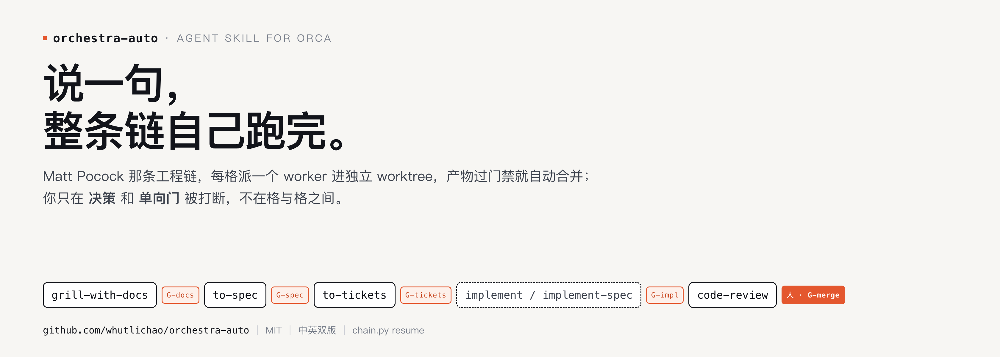
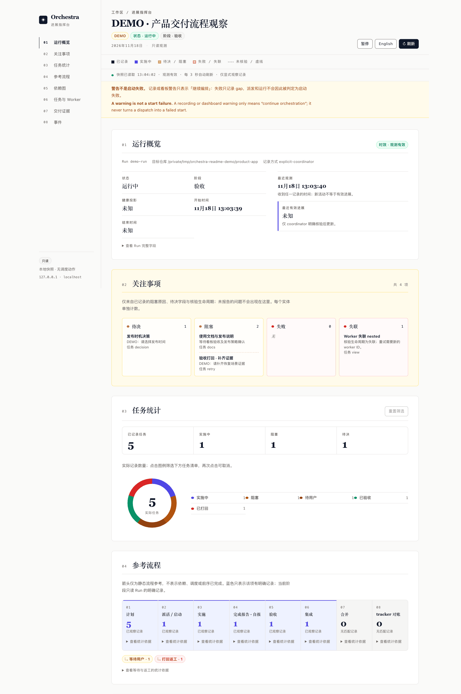

# orchestra-auto

**[English](README.md) · [简体中文](README.zh-CN.md)**

[](https://skills.sh/whutlichao/orchestra-auto) [](https://github.com/whutlichao/orchestra-auto/actions/workflows/tests.yml) [](./LICENSE)



一套把 [Matt Pocock 的工程 skill 链](https://github.com/mattpocock/skills) 放到 [Orca](https://www.onorca.dev/) 上作为监督式工作流跑完的 Agent Skill。说清一次目标，coordinator 按步派发 worker 到独立 worktree、校验门禁，并在获授权时自动合并（只要求开 PR 时保持开放）；你只在需要决策或遇到单向门时介入。

> **需要 [Orca](https://www.onorca.dev/)（`orca orchestration`）与 [Matt Pocock 的 skill](https://github.com/mattpocock/skills)。** 本项目为独立社区工作流，Matt Pocock 未参与开发、维护或背书。

## 安装

```bash
# English
npx skills add whutlichao/orchestra-auto --skill orchestra-auto

# 简体中文
npx skills add whutlichao/orchestra-auto --skill orchestra-auto-zh
```

- 使用社区 [`skills` CLI](https://github.com/vercel-labs/skills) 安装（不要用 `orca skills install`），可按需加 `--global` 或 `--agent <name>`。
- 中英文为两个独立安装包，共享同一套脚本与流程规则。
- **Orca Bot（可选，一键克隆安装）**：在 Orca 中打开 [Orchestra Auto 双语 Bot 分享链接](https://share.onorca.dev/bots/share/e0ec4dbaa384456bb7e63478493a4787) 即可创建副本并进入首次启动引导（详见 [docs/bots/orca-bot-guide.zh-CN.md](docs/bots/orca-bot-guide.zh-CN.md)）。

## 工作方式

可从任意已有阶段切入——从模糊想法到 spec、拆票或直接实施：

1. **路由** — 按当前阶段选择对应 skill（`grill-me` / `grill-with-docs` / `wayfinder` → `to-spec` → `to-tickets` → `implement` 或长程 `implement-spec`，以及 `diagnosing-bugs`、`research`、`triage`、`domain-modeling`、`retro`）。
2. **隔离与派发** — 每一步在新的顶层 worktree（`--worktree new-top-level`）中派发已启用的 Orca worker；coordinator 不直接修改目标项目文件。
3. **门禁与升级** — 按票型校验交付物（`tdd`、`code-review`、diff/重排检查）。决策类问题（交付形态、方案分叉、范围、凭证、第三方、付费服务、人工审批、不可逆线上数据操作）一律交回人类确认。
4. **落地与收尾** — 获授权且门禁全绿的双向门 PR 自动合并并同步 `main`；单向 Merge Danger 门或只要求开 PR 的任务保持开放。worker 仅在结算并完成持久化收尾后才 release。

核心约束：

- `state: ready` 不代表 turn 已启动（需 `turnStart: observed` 或实际尝试证据），`worker_done` 不等于验收通过。
- 流程记录、台账与进度日志均存放在仓库之外（`scripts/flow.py`、`scripts/chain.py`、`scripts/preflight.py`、`scripts/closeout.py`）。
- 既可在前台 Orca 会话中运行，也可配置为可分享的常驻 **Orca Bot** 协调者（[docs/bots/SOUL.md](docs/bots/SOUL.md)、[docs/bots/orca-bot-guide.zh-CN.md](docs/bots/orca-bot-guide.zh-CN.md)），自带首次启动引导、运行态防冲突强去重与动态 `docs/agents/triage-labels.md` 解析。
- 完整规则见 [skills/orchestra-auto-zh/SKILL.md](skills/orchestra-auto-zh/SKILL.md)。

## 前提与能力边界

- **Orca**：CLI 可用（`ORCA_CLI_COMMAND`、`orca`、`orca-dev` 或 `orca-ide`），并已启用 worker agent。
- **Matt Pocock 的 skill**：已安装在本机（由 worker spec 引用其路径）。
- **Node.js / `npx`**：仅用于通过 `skills` CLI 安装。
- **Python 3**：仅依赖标准库（macOS / Linux / WSL），用于编排辅助脚本与本地进度看板。

## 本地进度看板

只读、不阻塞编排的本地旁路看板（仅 Python 3 标准库，无数据库与凭证）。每次真实编排首次派活前，coordinator 在仓库外初始化状态并执行 `open` 注册 Run、拉起每用户单例服务；若无法自动打开浏览器，可按输出 URL 手动访问。看板故障绝不阻断派发。

服务通过 `run_states` 跟踪已注册 Run，并可在顶栏右侧下拉切换不同 Run。历史记录由服务与 `open` 绝不删除，仅显式执行 `registry prune` 时才归档已结束 Run 到 `archive/`。



运行离线 **DEMO** 可使用 `serve`（打印 `http://127.0.0.1:8766/`，不打开浏览器）：

```bash
python3 skills/orchestra-auto-zh/scripts/progress-demo.py --state "$AUDIT_ROOT/demo-example" --target-repo "$PWD"
python3 skills/orchestra-auto-zh/scripts/progress.py --state "$AUDIT_ROOT/demo-example" serve --port 8766
```

## 仓库结构与验证

```text
skills/
├── orchestra-auto/      英文包（SKILL.md：10,564 字节 / ~2,641 tokens；结构相同）
└── orchestra-auto-zh/   中文包（SKILL.md：9,641 字节 / ~2,410 tokens；references/ 共 8 个文件）
tests/                   离线 unittest 套件（脚本、看板、包一致性与脱敏扫描）
docs/                    设计、架构文档与演示素材（见 docs/INDEX.md）
```

运行完整离线测试（无需网络或凭证）：

```bash
python3 -m unittest discover -s tests -v
```

两个语言包各附带 **55 个提示词层面的场景**（`evals/evals.json`）；跨语言一致性测试只查锚点，不等于完整语义等价。更多设计文档与贡献规范见 [docs/INDEX.md](docs/INDEX.md) 与 [CONTRIBUTING.md](CONTRIBUTING.md)。

## 致谢与许可

- 规划链 skill：[Matt Pocock](https://github.com/mattpocock/skills)（未参与本项目开发，亦未背书）。
- 贡献者：[@dxnnystyles](https://github.com/dxnnystyles)（[PR #49](https://github.com/whutlichao/orchestra-auto/pull/49)）。
- 许可：[MIT](LICENSE)，版权 2026 whutlichao。
